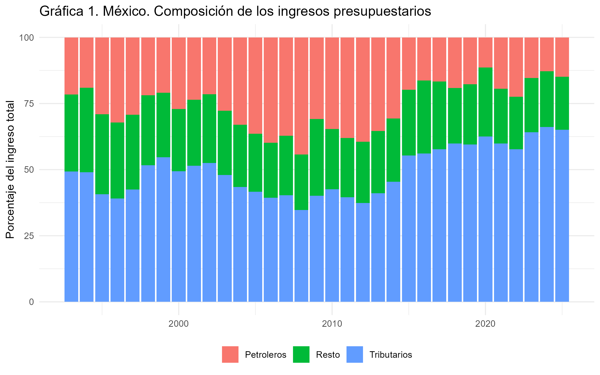
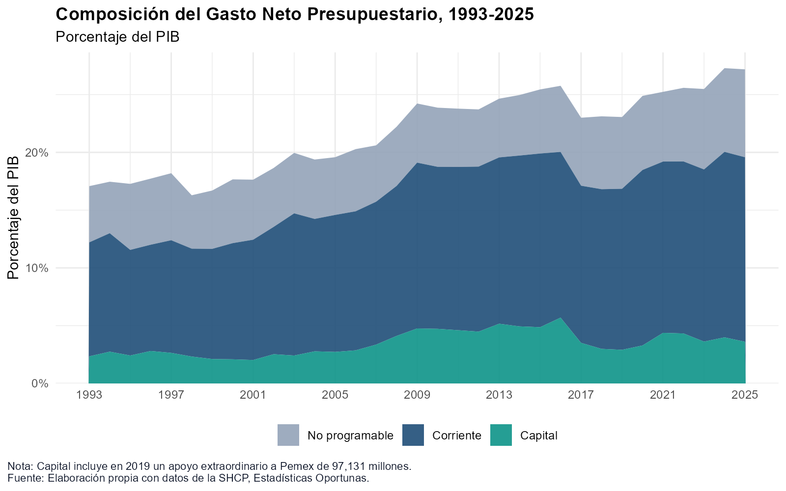
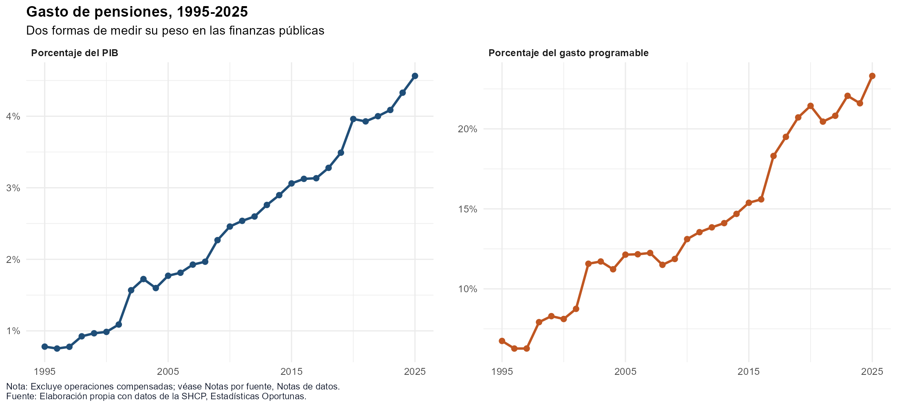

# Finanzas públicas de México, 1993-2025

Este proyecto describe cómo cambiaron entre 1993 y 2025 la composición de los ingresos presupuestarios, la recaudación tributaria, el gasto neto, la inversión física, el gasto en pensiones y el saldo histórico de los requerimientos financieros del sector público (SHRFSP). Usa las Estadísticas Oportunas de Finanzas Públicas de la SHCP y el PIB trimestral de INEGI, y expresa las series como porcentaje del PIB nominal. Es un análisis descriptivo: muestra qué cambió y cuándo, no por qué.

El análisis completo está en `analisis/analisis_finanzas_publicas_mexico.md`; este README es un resumen.

## Contenido

- [Preguntas que responde](#preguntas-que-responde)
- [Resultados principales](#resultados-principales)
- [Alcance](#alcance)
- [Fuente de los datos](#fuente-de-los-datos)
- [Metodología](#metodología)
- [Estructura del proyecto](#estructura-del-proyecto)
- [Requisitos y ejecución](#requisitos-y-ejecución)
- [Limitaciones](#limitaciones)
- [Referencias](#referencias)
- [Autoría y licencia](#autoría-y-licencia)

## Preguntas que responde

1. ¿Qué proporción de los ingresos presupuestarios han aportado los ingresos petroleros, los tributarios no petroleros y el resto entre 1993 y 2025, y cómo cambió?
2. ¿Cómo cambió la recaudación tributaria no petrolera como porcentaje del PIB entre 1993 y 2025, y cómo se compone entre ISR, IVA e IEPS?
3. ¿Cómo cambió el gasto neto total como porcentaje del PIB entre 1993 y 2025, y cuál es su composición (corriente, capital y no programable)?
4. ¿Cómo cambió la inversión física como porcentaje del PIB entre 1993 y 2025, y qué parte corresponde a inversión directa e indirecta?
5. ¿Cómo cambió el gasto en pensiones como porcentaje del PIB y del gasto programable entre 1995 y 2025?
6. ¿Cómo cambió el saldo histórico de los RFSP como porcentaje del PIB entre 2000 y 2025, y qué parte es interna y externa?

## Resultados principales

**1. Composición de los ingresos**

- Los ingresos tributarios del Gobierno Federal pasan de 49.3% a 65.0% de los ingresos presupuestarios entre 1993 y 2025, los petroleros bajan de 21.6% a 14.8%, y el resto, de 29.1% a 20.1%.
- Los tributarios son el componente mayor en 30 de los 33 años. Los petroleros los superan solo en 2006, 2008 y 2012, y alcanzan su máximo en 2008 (44.3%) y su mínimo en 2020 (11.3%).
- La definición de petroleros cambia en 2015, por lo que la comparación entre etapas no es estricta (ver [Limitaciones](#limitaciones)).



**2. Recaudación tributaria no petrolera**

- Sube de 8.7% a 15.2% del PIB. Entre 1993 y 2013 oscila entre 6.9% y 9.3%, y entre 2013 y 2015 pasa de 9.2% a 12.3%.
- De los 6.49 puntos que sube entre 1993 y 2025, el ISR aporta +3.99, el IVA +2.24, el IEPS +0.73 y los otros impuestos −0.47. El ISR supera al IVA y el IVA al IEPS en los 33 años.
- El IEPS es negativo en seis años (2006-2008 y 2011-2013), por lo que la composición se presenta en puntos del PIB.

**3. Gasto neto total**

- Sube de 17.1% a 27.2% del PIB. El programable pasa de 12.2% a 19.6%, y el no programable, de 4.9% a 7.6%.
- Dentro del programable, el gasto corriente representa más del 71% en todos los años, y el capital, más del 16%.



**4. Inversión física**

- Es 2.2% del PIB en 1993 y en 2025, pero entre 2009 y 2015 se mantiene entre 4.0% y 4.5% y después cae.
- La inversión directa baja de 1.9% a 1.2% del PIB, y la indirecta sube de 0.3% a 0.9%. De 2017 a 2025 la indirecta representa más de 40% de la inversión física, contra 14.2% en 1993.

**5. Gasto en pensiones**

- Pasa de 0.8% a 4.6% del PIB y de 6.7% a 23.3% del gasto programable, y aumenta en 27 de los 30 cambios anuales.



**6. Saldo histórico de los RFSP**

- Pasa de 29.2% del PIB en 2000 a 52.6% en 2025. El componente interno sube de 18.5% a 40.7%, y el externo, de 10.7% a 11.9%. En 2025, el saldo interno es 77.4% del total.

**Por sexenio** (promedios de años calendario completos, 1995-2024)

- El gasto neto total sube en cada sexenio, de 17.3% a 25.3% del PIB, y el gasto en pensiones pasa de 0.9% a 4.0%.
- La recaudación tributaria sube en tres de los cuatro cambios entre sexenios, y la excepción es 2007-2012.
- La inversión física sube de 2.1% (2001-2006) a 3.8% (2007-2012) y baja en los dos sexenios siguientes (3.6% y 2.8%).

## Alcance

**Incluye**

- Ingresos presupuestarios, gasto neto, inversión física, gasto en pensiones y saldo histórico de los RFSP, en millones de pesos corrientes.
- Series expresadas como porcentaje del PIB nominal, de 1993 a 2025 (las pensiones, desde 1995, y el saldo, desde 2000).
- Una tabla de promedios por sexenio, de 1995 a 2024.

**No incluye**

- Causas de los cambios ni evaluación de políticas o administraciones.
- Gobiernos estatales y municipales ni entidades fuera del sector público presupuestario.
- Montos reales: se trabaja con proporciones, y no se deflacta.

## Fuente de los datos

| Fuente | Datos | Consulta |
|---|---|---|
| SHCP, Estadísticas Oportunas de Finanzas Públicas | Ingresos Presupuestarios del Sector Público, Gasto Neto del Sector Público Presupuestario y Saldo Histórico de los Requerimientos Financieros del Sector Público | 22 de octubre de 2026 |
| INEGI, Banco de Información Económica | PIB trimestral a precios de 2018 y a precios corrientes (series originales) | 22 de octubre de 2026 |

**Parámetros de consulta (SHCP):** cuadro "Pesos corrientes multianual" en millones de pesos, de 1990 a 2025, opción anual (ingresos y gasto), y cuadro "Saldo multianual" con periodo diciembre (saldo histórico).

**Archivos procesados** (generados por dos scripts de R a partir de `data/raw/`):

| Archivo | Contenido | Dimensiones | Periodo |
|---|---|---|---|
| `data/processed/base_finanzas_publicas.csv` | Ingreso, gasto y saldo, con variables renombradas (millones de pesos corrientes) | 36 filas × 23 columnas | 1990-2025 |
| `data/processed/pib_real_nominal_anual.csv` | `pib_real` y `pib_nominal`, como promedio anual de los cuatro trimestres | 46 filas × 3 columnas | 1980-2025 |

**Notas sobre los datos**

- Los archivos de SHCP se descargan en formato `.xls`; su contenido se copió sin cambios a `.xlsx`, que es lo que se guarda en `data/raw/`.
- Los CSV de INEGI vienen en UTF-16. El BIE rotula la serie nominal como "a precios de 2018", pero sus valores son corrientes.
- El detalle de variables, renombres y notas por fuente está en los anexos y en las Notas de datos del análisis.

## Metodología

- **Porcentaje del PIB.** Cada serie se divide entre el PIB nominal anual (promedio simple de los cuatro trimestres; Heath, 2012, p. 72) y los cálculos usan valores sin redondear.
- **Composición de los ingresos.** Petroleros, tributarios no petroleros del Gobierno Federal y resto (ingreso total menos petroleros menos tributarios).
- **Composición del gasto.** Total = programable + no programable, y programable = corriente + capital.
- **Sexenios.** Promedio simple de los valores anuales, con años calendario completos (1995-2000, 2001-2006, 2007-2012, 2013-2018 y 2019-2024). Los petroleros no entran en la tabla por el cambio de definición de 2015.

## Estructura del proyecto

```
finanzas_publicas_mexico/
├── analysis/
│   ├── analisis_finanzas_publicas_mexico.md
│   └── analisis_finanzas_publicas_mexico.Rmd
├── data/
│   ├── processed/
│   │   ├── base_finanzas_publicas.csv
│   │   └── pib_real_nominal_anual.csv
│   └── raw/
│       ├── gasto_neto_presupuestario.xlsx
│       ├── ingreso_presupuestario.xlsx
│       ├── pib_precios_2018.csv
│       ├── pib_precios_corrientes.csv
│       └── saldo_requerimientos_financieros.xlsx
├── figures/
│   ├── grafica_01_ingresos_composicion.png
│   ├── grafica_02_recaudacion_tributaria.png
│   ├── grafica_03_composicion_gasto_neto.png
│   ├── grafica_04_inversion_fisica.png
│   ├── grafica_05_gasto_pensiones.png
│   └── grafica_06_composicion_saldo.png
├── scripts/
│   ├── preparar_base_finanzas_publicas.R
│   └── preparar_base_pib_anual.R
├── .gitignore
├── finanzas_publicas_mexico.Rproj
├── LICENSE
└── README.md
```

## Requisitos y ejecución

El análisis se desarrolla en R Markdown y se ejecuta desde RStudio.

| Herramienta | Versión |
|---|---|
| R | [VERSIÓN_DE_R] |
| tidyverse | [VERSIÓN_DE_TIDYVERSE] |

El análisis también usa `knitr` y `rmarkdown`.

1. Clona el repositorio y abre el archivo `.Rproj` en RStudio:

   ```bash
   git clone https://github.com/Jose-Castanedas/finanzas_publicas_mexico.git
   ```

2. Instala los paquetes:

   ```r
   install.packages(c("tidyverse", "knitr", "rmarkdown"))
   ```

3. Opcional: ejecuta los scripts de `scripts/` desde la raíz del proyecto para regenerar los archivos de `data/processed/` a partir de `data/raw/`.
4. Abre `analisis/analisis_finanzas_publicas_mexico.Rmd` y renderízalo con **Knit**. El análisis lee los archivos procesados con rutas relativas (`../data/processed/`) y guarda las gráficas en `../figures/`.

## Limitaciones

- Los ingresos y el gasto cubren el sector público presupuestario (Gobierno Federal, IMSS, ISSSTE, Pemex y CFE), no los gobiernos estatales ni municipales. El saldo histórico tiene una cobertura más amplia.
- La definición de los ingresos petroleros cambia en 2015 (hasta 2014, derechos sobre hidrocarburos; desde 2015, transferencias del Fondo Mexicano del Petróleo e ISR de contratistas y asignatarios), por lo que la comparación entre etapas no es estricta.
- Los tributarios y no tributarios son los del Gobierno Federal y no suman el total; el resto se obtiene por diferencia.
- La fuente no define "gasto de pensiones" ni "inversión directa e indirecta"; el análisis reporta sus cifras sin interpretar su alcance. Tampoco indica si la serie de pensiones excluye las operaciones compensadas.
- El gasto de capital de 2019 incluye un apoyo extraordinario a Pemex de 97,131 millones de pesos (0.39 puntos del PIB).
- Los porcentajes usan el PIB nominal de INEGI (base 2018) y pueden diferir de los que publica SHCP: el saldo de 2018 es 43.6% con este análisis y 44.8% en SHCP (2019).
- El IEPS es negativo en seis años, por lo que la composición tributaria se presenta en puntos del PIB.
- El saldo histórico es una existencia a diciembre, empieza en 2000 y sus cambios incluyen revalorizaciones que no se pueden separar con estos datos.
- Los sexenios usan años calendario completos y el promedio oculta variaciones anuales; no se atribuyen resultados a administraciones.
- Las cifras pueden revisarse: si consultas los datos en otra fecha, los resultados pueden cambiar.

## Referencias

- Cámara de Diputados del H. Congreso de la Unión. (s. f.). Las finanzas públicas. Recuperado el 27 de octubre de 2026, de 
https://www.diputados.gob.mx/bibliot/publica/inveyana/econycom/reportes/finpubli.htm
- Heath, J. (2012). Lo que indican los indicadores: cómo utilizar la información estadística para entender la realidad económica de México. Instituto Nacional de Estadística y Geografía (INEGI).
- Instituto Nacional de Estadística y Geografía. (2026). ABC de las finanzas públicas estatales y municipales.
https://www.inegi.org.mx/contenidos/productos/prod_serv/contenidos/espanol/bvinegi/productos/nueva_estruc/889463929697.pdf
- Instituto Nacional de Estadística y Geografía. (s. f.). Banco de Información Económica (BIE): indicadores económicos de coyuntura [Base de datos]. https://www.inegi.org.mx/app/indicadores/?tm=3
- Secretaría de Hacienda y Crédito Público. (2019, abril). Balance fiscal en México: Definición y metodología. 
https://gaceta.diputados.gob.mx/Gaceta/64/2019/may/SHCP_BF-20190521.pdf
- Secretaría de Hacienda y Crédito Público. (2026). Saldo histórico de los requerimientos financieros del sector público (SHRFSP), deuda amplia, 2000–2014 [Conjunto de datos]. Datos.gob.mx. 
https://www.datos.gob.mx/dataset/saldo_historico_requerimientos_financieros_sector_publico_shrfsp_deuda_amplia_2000_2014
- Secretaría de Hacienda y Crédito Público. (s. f.). Estadísticas Oportunas de Finanzas Públicas [Base de datos]. http://presto.hacienda.gob.mx/EstoporLayout/estadisticas.jsp

## Autoría y licencia

Autor: Jose Guadalupe Castañeda Soto

El código de este proyecto se publica bajo la licencia MIT (ver el archivo `LICENSE`). Los datos pertenecen a SHCP e INEGI y se rigen por sus propios términos de uso.