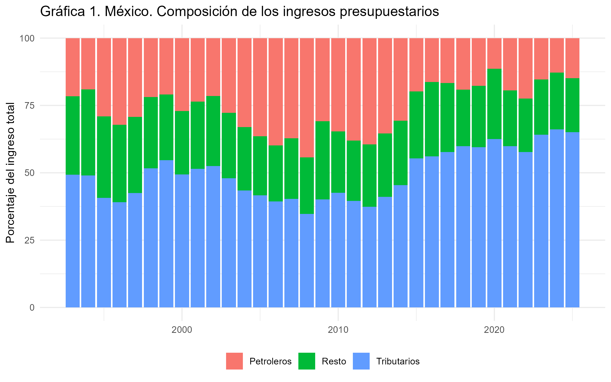

Las finanzas públicas comprenden el conjunto de ingresos, gastos y deuda del sector público, con el que el Estado cumple sus objetivos y funciones.

En México, los instrumentos de las finanzas públicas son (Cámara de Diputados, s.f.):

- Los ingresos públicos
- El gasto público
- El endeudamiento interno y externo del Estado
- Los precios y las tarifas de los bienes y servicios

Este análisis utiliza datos de los ingresos y gastos presupuestarios y del saldo histórico de los requerimientos financieros del sector público, que se definen de la siguiente manera:

- **Ingresos presupuestarios del sector público:** son los recursos que obtiene el Estado de las contribuciones obligatorias y que usa para sufragar el gasto público (SHCP, 2019, p.14).

- **Gasto neto del sector público presupuestario:** es el total de erogaciones que realiza el sector público para proveer bienes y servicios (SHCP, 2019, p.15).

- **Saldo histórico de los requerimientos financieros del sector público:** mide la deuda neta acumulada del sector público e incluye las obligaciones del IPAB, el FONADIN, los PIDIREGAS y los programas de apoyo a deudores, junto con la pérdida esperada de la banca de desarrollo (SHCP, 2026).

Las finanzas públicas permiten entender el uso de los recursos públicos y su impacto en la calidad de vida, además de evaluar al gobierno y fomentar la rendición de cuentas (INEGI, 2026, p.1).

El gobierno federal obtiene la mayor parte de sus ingresos a través del cobro de impuestos y los recursos generados por el petróleo, que son sus principales fuentes de financiamiento (INEGI, 2026, p.3) 

El objetivo del análisis es describir cómo cambian, entre 1993 y 2025, la composición de los ingresos, del gasto y de la inversión física, y el peso del gasto en pensiones. El enfoque es descriptivo y no establece causas.

**Preguntas de investigación**

1. ¿Qué proporción de los ingresos presupuestarios han aportado los ingresos petroleros, los tributarios no petroleros y el resto entre 1993 y 2025, y cómo cambió?

2. ¿Cómo cambió la recaudación tributaria no petrolera como porcentaje del PIB entre 1993 y 2025, y cómo se compone entre ISR, IVA e IEPS?

3. ¿Cómo cambió el gasto neto total como porcentaje del PIB entre 1993 y 2025, y cuál es su composición (corriente, capital y no programable)?

4. ¿Cómo cambió la inversión física como porcentaje del PIB entre 1993 y 2025, y qué parte corresponde a inversión directa e indirecta?

5. ¿Cómo cambió el gasto en pensiones como porcentaje del PIB y del gasto programable entre 1995 y 2025?

## Fuente

**Instituciones y fuentes:**

- Secretaría de Hacienda y Crédito Público (SHCP), Estadísticas Oportunas de Finanzas Públicas.
- INEGI, Banco de Información Económica.

**Canales de consulta:**

- Estadísticas Oportunas
  - URL: http://presto.hacienda.gob.mx/EstoporLayout/estadisticas.jsp

- Banco Información Económica
  - URL: https://www.inegi.org.mx/app/indicadores/?tm=3

**Datos consultados:**

- SHCP
  - Ingresos Presupuestarios del Sector Público
  - Gasto Neto del Sector Público Presupuestario
  - Saldo Histórico de los Requerimientos Financieros del Sector Público (2000-2026)

- INEGI
  - Producto Interno Bruto valores a precios de 2018
  - Producto Interno Bruto valores a precios corrientes

**Fecha de consulta:** 22 de octubre de 2026

**Parámetros de consulta:**

- **Ingreso y Gasto Neto Presupuestario**
  - Cuadro: Pesos corrientes multianual
  - Cifras en: Millones de pesos
  - De: 1990
  - A: 2025
  - Opción lateral: Anual

- **Saldo Histórico de los RFSP**
  - Cuadro: Saldo multianual
  - Cifras en: Millones de pesos
  - De: 1990
  - A: 2025
  - Periodo: Diciembre

**Rutas de descarga:**

- **Ingresos Presupuestarios del Sector Público**

Estadísticas Oportunas de Finanzas Públicas > Ingreso, gasto y financiamiento del sector público > Ingresos Presupuestarios > Ingresos Presupuestarios del Sector Público

- **Gasto Neto del Sector Público Presupuestario**

Estadísticas Oportunas de Finanzas Públicas > Ingreso, gasto y financiamiento del sector público > Gastos Presupuestarios > Gasto Neto del Sector Público Presupuestario

- **Saldo Histórico de los Requerimientos Financieros del Sector Público (2000-2026)**

Estadísticas Oportunas de Finanzas Públicas > Requerimientos Financieros del Sector Público > Saldo Histórico de los Requerimientos Financieros del Sector Público > Saldo Histórico de los Requerimientos Financieros del Sector Público (2000–2026)

- **Producto Interno Bruto valores a precios de 2018**

Indicadores económicos de coyuntura > Producto interno bruto trimestral, base 2018 > Series originales > Valores a precios de 2018 > Producto Interno Bruto (Millones de pesos a precios de 2018) Trimestral.

- **Producto Interno Bruto valores a precios corrientes**

Indicadores económicos de coyuntura > Producto interno bruto trimestral, base 2018 > Series originales > Valores a precios corrientes > Producto Interno Bruto (Millones de pesos a precios de 2018) Trimestral

## Notas de datos

**Periodos**

Los datos incluyen el total de periodos disponibles en cada fuente:

- Ingresos presupuestarios: 1990-2025
- Gasto neto presupuestario: 1990-2025
- Saldo histórico de los RFSP: 1990-2025
- PIB a precios de 2018: 1T-1980 – 2T-2026
- PIB a precios corrientes: 1T-1993 – 2T-2026

**Periodo de análisis**

El PIB nominal es el denominador de la mayoría de los cálculos, por lo que el análisis abarca 1993-2025, periodo con PIB nominal anual disponible. La pregunta 5 inicia en 1995, primer año con datos de gasto en pensiones.

**Cifras**

- Ingresos presupuestarios: millones de pesos (flujos acumulados)
- Gasto neto presupuestario: millones de pesos (flujos acumulados)
- Saldo Histórico de los RFSP: millones de pesos
- PIB a precios de 2018: millones de pesos a precios de 2018
- PIB a precios corrientes: millones de pesos corrientes. El BIE rotula la serie como "a precios de 2018", pero los valores son corrientes.

**Notas por fuente**

**Ingresos**

- Se toman los conceptos Tributarios y No tributarios del Gobierno Federal, no los de Partidas informativas.
- El concepto Petroleros incluye, hasta 2014, los ingresos propios de Pemex y los derechos sobre hidrocarburos. A partir de 2015 incluye los ingresos propios de Pemex, las transferencias del Fondo Mexicano del Petróleo para la Estabilización y el Desarrollo y el impuesto sobre la renta de contratistas y asignatarios por explotación de hidrocarburos.
- El IEPS total tiene valores negativos en 2006, 2007, 2008, 2011, 2012 y 2013. El IEPS gasolinas y diesel los tiene en 2006, 2007, 2008, 2010, 2011, 2012, 2013, 2014 y 2022. El IEPS distinto de gasolinas y diesel no tiene valores negativos.

**Gasto**

- El Gasto de pensiones pertenece a Partidas informativas y no tiene datos para 1990-1994.
- Para no contabilizar dos veces el ingreso y el gasto público, el concepto Programable excluye las operaciones compensadas, es decir, las transacciones que representan un ingreso para las entidades bajo control presupuestario directo y un gasto para el Gobierno Federal (subsidios, transferencias y aportaciones al ISSSTE).
- Capital incluye en 2019 un apoyo extraordinario a Pemex de 97,131 millones (nota del cuadro).

**Saldo**

- Las cifras corresponden al cuadro Saldo multianual, periodo Diciembre (1990-2025).
- No hay datos para 1990-1999.

**PIB**

- Las cifras de los dos trimestres de 2026 son revisadas (r1).
- El PIB anual es el promedio simple de los cuatro trimestres del año (Heath, 2012, p.72). El cálculo es igual para ambas series.
- La serie a precios de 2018 se renombra pib_real y la de precios corrientes, pib_nominal.

**Valores faltantes (NA)**

- gasto_pensiones: 1990-1994
- shrfsp, shrfsp_interno y shrfsp_externo: 1990-1999
- pib_nominal: 1980-1992

Los archivos conservan todos los años disponibles. Para el análisis se toma el periodo de 1993-2025.

## Fórmula

- Porcentaje del PIB

  concepto (% del PIB) = concepto / pib_nominal * 100

- Resto de los ingresos presupuestarios

  Resto = Ingreso Total - Petroleros - Tributarios del Gobierno Federal

- Composición porcentual

  concepto (% de composición) = concepto / total * 100

  Donde total es el agregado al que pertenece el concepto.

## Código

```{r Preparar-datos, message=FALSE}
# Cargar librerías

library(tidyverse)
library(knitr)

# Cargar bases de datos procesadas

base_finanzas_publicas <- read.csv("../data/processed/base_finanzas_publicas.csv")
base_pib_anual <- read.csv("../data/processed/pib_real_nominal_anual.csv")

# Filtrar ambas bases al periodo 1993-2025

base_finanzas_publicas <- base_finanzas_publicas %>%
  filter(between(anio, 1993, 2025))

base_pib_anual <- base_pib_anual %>%
  filter(between(anio, 1993, 2025))

# Unir ambas bases por año en una sola

base_completa <- base_finanzas_publicas %>%
  left_join(base_pib_anual, by = "anio")
```

```{r Calcular-conceptos-como-pct-del-pib, echo=TRUE}
# Calcular cada concepto como % del PIB nominal (pct_pib)

base_completa <- base_completa %>%
  mutate(across(gasto_total:shrfsp_externo, ~ .x / pib_nominal * 100, .names = "{.col}_pct_pib"))
```

## Preguntas

### 1. ¿Qué proporción de los ingresos presupuestarios han aportado los ingresos petroleros, los tributarios no petroleros y el resto entre 1993 y 2025, y cómo cambió?

```{r Pregunta-1, echo=TRUE}
# Filtrar solo las columnas a usar: anio, ingreso_total, petroleros, no_petroleros y tributarios_gf

pct_ingresos <- base_completa %>%
  select(anio, ingreso_total:tributarios_gf)

# Calcular columna resto

pct_ingresos <- pct_ingresos %>%
  mutate(resto = ingreso_total - petroleros - tributarios_gf)

# Calcular el porcentaje de proporción de los ingresos presupuestarios

pct_ingresos <- pct_ingresos %>%
  mutate(across(petroleros:resto, ~ .x / ingreso_total * 100, .names = "{.col}_pct_ingresos"))

# Mostrar datos

pct_ingresos %>%
  select(anio, petroleros_pct_ingresos, tributarios_gf_pct_ingresos, resto_pct_ingresos) %>%
  filter(anio %in% c(2006, 2008, 2012, 2015:2025)) %>%
  kable(
    digits = 1,
    col.names = c("Año", "Petroleros (%)", "Tributarios (%)", "Resto (%)")
  )
```

```{r Pregunta-1-grafica, echo=TRUE, fig.alt="Barras apiladas con la composición porcentual de los ingresos presupuestarios de México entre 1993 y 2025: petroleros, tributarios y resto."}
# Gráfica composición del ingreso presupuestario

# 1. Pasar a formato largo

ingresos_largo <- pct_ingresos %>%
  select(anio, petroleros_pct_ingresos, tributarios_gf_pct_ingresos, resto_pct_ingresos) %>%
  pivot_longer(
    cols = -anio,
    names_to = "concepto",
    values_to = "pct"
  ) %>%
  mutate(concepto = recode(concepto,
    petroleros_pct_ingresos = "Petroleros",
    tributarios_gf_pct_ingresos = "Tributarios",
    resto_pct_ingresos = "Resto"),
    concepto = factor(concepto, levels = c("Petroleros", "Tributarios", "Resto")))

# 2. Configurar barras apiladas

# 2.1. Definir paleta de colores

colores <- c("Petroleros" = "#C05621", "Tributarios" = "#1F4E78", "Resto" = "#94A3B8")

# 2.2. Configurar diseño de gráfica

grafica_composicion <- ggplot(ingresos_largo, aes(x = anio, y = pct, fill = concepto)) +
  geom_col(width = 0.95, position = position_stack(reverse = TRUE)) +
  
  # 2.3. Mostrar etiquetas únicamente en el primer y último año
  geom_text(
    data = filter(ingresos_largo, anio %in% c(1993, 2025)),
    aes(label = paste0(round(pct), "%")),
    position = position_stack(vjust = 0.5, reverse = TRUE),
    color = "#FFFFFF", size = 2.5, fontface = "bold"
  ) +
  scale_fill_manual(values = colores) +
  scale_x_continuous(breaks = seq(1993, 2025, 4), expand = c(0, 0)) +
  scale_y_continuous(labels = scales::label_percent(scale = 1), expand = c(0, 0)) +
  labs(
    title = "Composición de los ingresos presupuestarios, 1993-2025",
    subtitle = "Ingresos presupuestarios del sector público",
    x = NULL,
    y = "Porcentaje del ingreso total",
    fill = NULL,
    caption = "Notas: Petroleros: cambio metodológico en 2015 (ver Notas de datos). Tributarios = ingresos tributarios del Gobierno Federal. \nResto = ingreso total - petroleros - tributarios. \nFuente: Elaboración propia con datos de SHCP, Estadísticas Oportunas."
  ) +
  theme_minimal(base_size = 12) +
  theme(
    legend.position = "bottom",
    panel.grid.major.x = element_blank(),
    panel.grid.minor = element_blank(),
    plot.title = element_text(face = "bold"),
    plot.caption = element_text(hjust = 0, size = 8, color = "#0F172A"),
    plot.caption.position = "plot")

# 3. Guardar gráfica en el directorio figures

ggsave("../figures/grafica_01_ingresos_composicion.png",
       plot = grafica_composicion,
       width = 8, height = 5, dpi = 200)

# 4. Mostrar gráfica


```

Los ingresos tributarios del Gobierno Federal son el componente más grande de los ingresos presupuestarios en 30 de los 33 años del periodo 1993-2025. Los ingresos petroleros lo superan solo en 2006, 2008 y 2012, con 39.8%, 44.3% y 39.4% del total, respectivamente. En 2006 superaron a los tributarios (39.3%) por 0.5 puntos porcentuales (el concepto Petroleros cambia de composición en 2015, ver Notas de datos para más detalles).

**Composición del ingreso (participación %)**

| Componente | Mínimo | Máximo |
| :--- | :--- | :--- |
| Petroleros | 11.3% (2020) | 44.3% (2008) |
| Tributarios | 34.8% (2008) | 66.1% (2024) |
| Resto | 19.9% (2022) | 31.9% (1994) |

Los ingresos tributarios representan más del 60% de los ingresos presupuestarios en los últimos tres años: 64.2% en 2023, 66.1% en 2024 y 65.0% en 2025. Superan el 50% de manera continua desde 2015.

## Anexos

**Conceptos y renombres**

**Gasto**

| Concepto en la fuente | Variable | Rama |
| :--- | :--- | :--- |
| Total | gasto_total | |
| Programable | programable | |
| No programable | no_programable | |
| Corriente | corriente | Programable |
| Capital | capital | Programable |
| Inversión física | inversion_fisica | Programable > Capital |
| Directo | inversion_directa | Inversión física |
| Indirecto | inversion_indirecta | Inversión física |
| Gasto de pensiones | gasto_pensiones | Partidas informativas |

**Ingreso**

| Concepto en la fuente | Variable | Rama |
| :--- | :--- | :--- |
| Total | ingreso_total | |
| Petroleros | petroleros | |
| No petroleros | no_petroleros | |
| Tributarios | tributarios_gf | No petroleros > Gobierno Federal |
| No tributarios | no_tributarios_gf | No petroleros > Gobierno Federal |
| Impuesto sobre la renta | isr | Tributarios |
| Impuesto al valor agregado | iva | Tributarios |
| Impuesto especial sobre producción y servicios | ieps | Tributarios |
| IEPS gasolinas y diesel | ieps_gasolinas | Tributarios |
| IEPS distinto de gasolinas y diesel | ieps_distinto | Tributarios |

**Saldo**

| Concepto en la fuente | Variable |
| :--- | :--- |
| Saldo histórico de los RFSP | shrfsp |
| Interno | shrfsp_interno |
| Externos | shrfsp_externo |

**Archivos procesados**

Dos scripts de R, ubicados en la carpeta scripts/, procesan los datos originales, en la carpeta raw/, y generan dos archivos CSV. Los archivos se guardan en data/processed/.

| Archivo | Contenido | Dimensiones | Periodo |
| :--- | :--- | :--- | :--- |
| base_finanzas_publicas.csv | Ingreso, gasto y saldo, con las variables renombradas (ver Conceptos y renombres). Millones de pesos corrientes. | 36 filas × 23 columnas | 1990-2025 |
| pib_real_nominal_anual.csv | pib_real y pib_nominal, ambos como promedio anual de los cuatro trimestres. | 46 filas × 3 columnas | 1980-2025 |

Ambos archivos comparten la columna anio que sirve como clave para unirlos.

## Referencias

- Cámara de Diputados del H. Congreso de la Unión. (s. f.). Las finanzas públicas. Recuperado el 27 de octubre de 2026, de 
https://www.diputados.gob.mx/bibliot/publica/inveyana/econycom/reportes/finpubli.htm
- Heath, J. (2012). Lo que indican los indicadores: cómo utilizar la información estadística para entender la realidad económica de México. Instituto Nacional de Estadística y Geografía (INEGI).
- Instituto Nacional de Estadística y Geografía. (2026). ABC de las finanzas públicas estatales y municipales.
https://www.inegi.org.mx/contenidos/productos/prod_serv/contenidos/espanol/bvinegi/productos/nueva_estruc/889463929697.pdf
- Secretaría de Hacienda y Crédito Público. (2019, abril). Balance fiscal en México: Definición y metodología. 
https://gaceta.diputados.gob.mx/Gaceta/64/2019/may/SHCP_BF-20190521.pdf
- Secretaría de Hacienda y Crédito Público. (2026). Saldo histórico de los requerimientos financieros del sector público (SHRFSP), deuda amplia, 2000–2014 [Conjunto de datos]. Datos.gob.mx. 
https://www.datos.gob.mx/dataset/saldo_historico_requerimientos_financieros_sector_publico_shrfsp_deuda_amplia_2000_2014