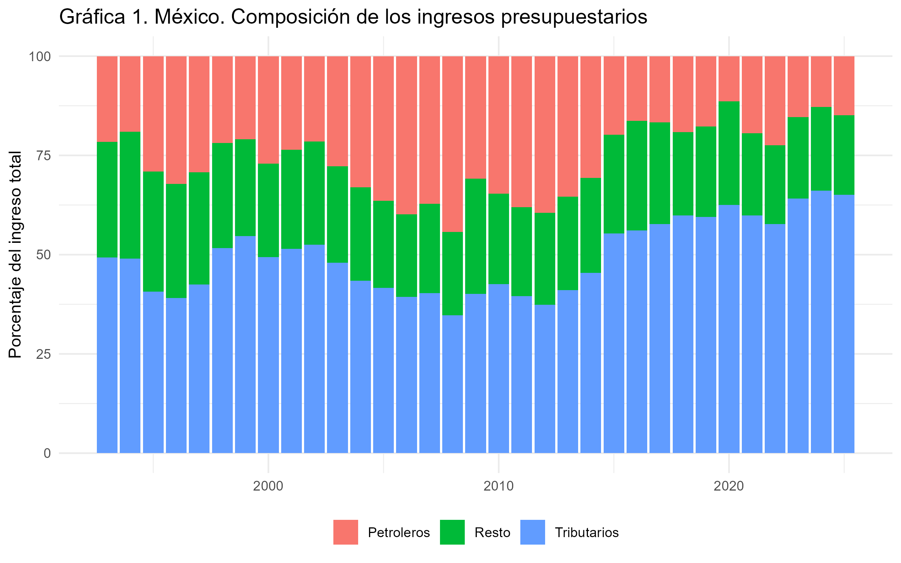
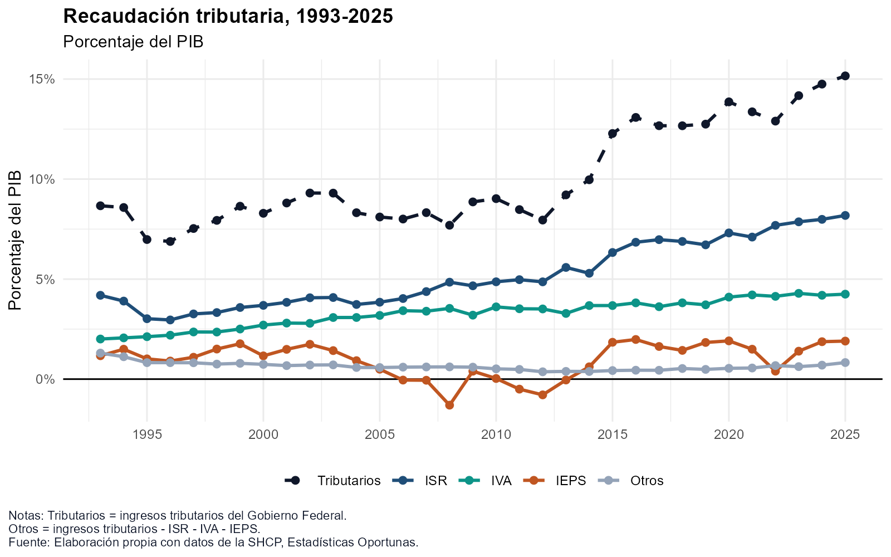
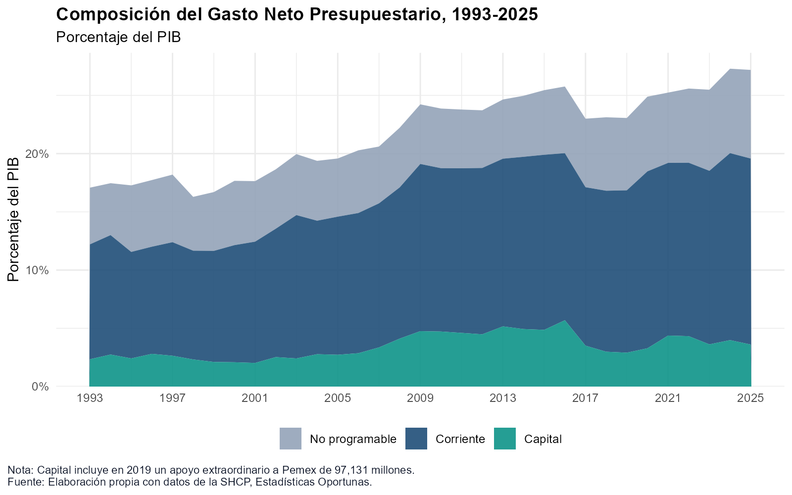
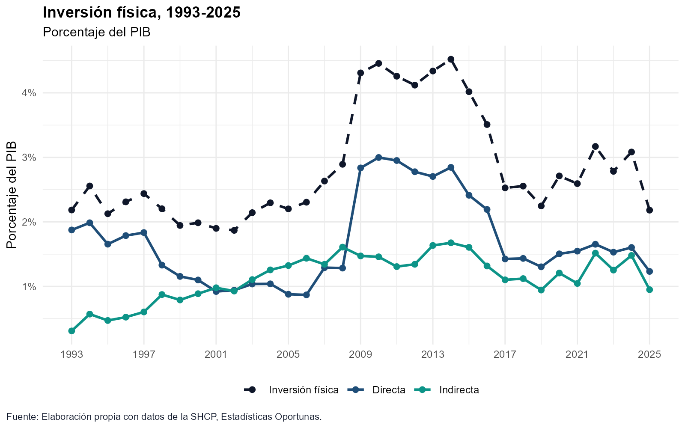
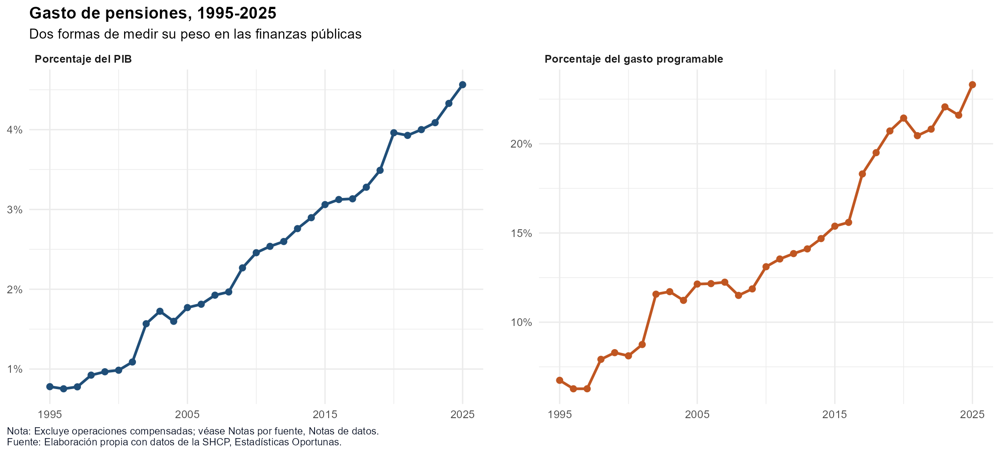
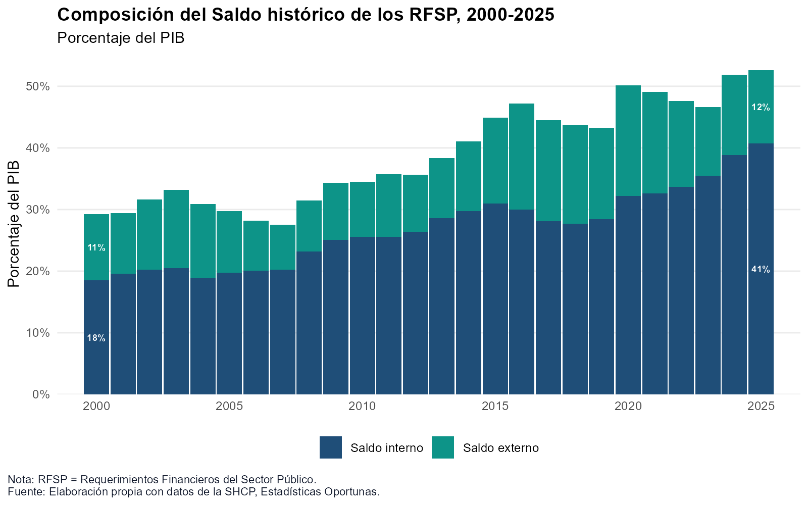

Análisis finanzas públicas de México, 1993-2025
================
Jose Guadalupe Castañeda Soto
2026-11-13

Las finanzas públicas comprenden el conjunto de ingresos, gastos y deuda
del sector público, con el que el Estado cumple sus objetivos y
funciones.

En México, los instrumentos de las finanzas públicas son (Cámara de
Diputados, s.f.):

- Los ingresos públicos
- El gasto público
- El endeudamiento interno y externo del Estado
- Los precios y las tarifas de los bienes y servicios

Este análisis utiliza datos de los ingresos y gastos presupuestarios y
del saldo histórico de los requerimientos financieros del sector
público, que se definen de la siguiente manera:

- **Ingresos presupuestarios del sector público:** son los recursos que
  obtiene el Estado de las contribuciones obligatorias y que usa para
  sufragar el gasto público. Incluye también productos,
  aprovechamientos, financiamiento y los ingresos de organismos
  descentralizados y empresas de participación estatal (SHCP, 2019,
  p.14).

- **Gasto neto del sector público presupuestario:** es el total de
  erogaciones que realiza el sector público para proveer bienes y
  servicios (SHCP, 2019, p.15).

- **Saldo histórico de los requerimientos financieros del sector
  público:** mide la deuda neta acumulada del sector público e incluye
  las obligaciones del IPAB, el FONADIN, los PIDIREGAS y los programas
  de apoyo a deudores, junto con la pérdida esperada de la banca de
  desarrollo (SHCP, 2026).

Las finanzas públicas permiten entender el uso de los recursos públicos
y su impacto en la calidad de vida, además de evaluar al gobierno y
fomentar la rendición de cuentas (INEGI, 2026, p.1).

El gobierno federal obtiene la mayor parte de sus ingresos a través del
cobro de impuestos y los recursos generados por el petróleo, que son sus
principales fuentes de financiamiento (INEGI, 2026, p.3).

El objetivo del análisis es describir cómo cambian, entre 1993 y 2025,
la composición de los ingresos, del gasto y de la inversión física, y el
peso del gasto en pensiones. El enfoque es descriptivo y no establece
causas.

**Preguntas de investigación**

1.  ¿Qué proporción de los ingresos presupuestarios han aportado los
    ingresos petroleros, los tributarios no petroleros y el resto entre
    1993 y 2025, y cómo cambió?

2.  ¿Cómo cambió la recaudación tributaria no petrolera como porcentaje
    del PIB entre 1993 y 2025, y cómo se compone entre ISR, IVA e IEPS?

3.  ¿Cómo cambió el gasto neto total como porcentaje del PIB entre 1993
    y 2025, y cuál es su composición (corriente, capital y no
    programable)?

4.  ¿Cómo cambió la inversión física como porcentaje del PIB entre 1993
    y 2025, y qué parte corresponde a inversión directa e indirecta?

5.  ¿Cómo cambió el gasto en pensiones como porcentaje del PIB y del
    gasto programable entre 1995 y 2025?

6.  ¿Cómo cambió el saldo histórico como porcentaje del PIB entre 2000 y
    2025, y qué parte es interna y externa?

## Fuente

**Instituciones y fuentes:**

- Secretaría de Hacienda y Crédito Público (SHCP), Estadísticas
  Oportunas de Finanzas Públicas.
- INEGI, Banco de Información Económica.

**Canales de consulta:**

- Estadísticas Oportunas
  - URL: <http://presto.hacienda.gob.mx/EstoporLayout/estadisticas.jsp>
- Banco Información Económica
  - URL: <https://www.inegi.org.mx/app/indicadores/?tm=3>

**Datos consultados:**

- SHCP
  - Ingresos Presupuestarios del Sector Público
  - Gasto Neto del Sector Público Presupuestario
  - Saldo Histórico de los Requerimientos Financieros del Sector Público
    (2000-2026)
- INEGI
  - Producto Interno Bruto valores a precios de 2018
  - Producto Interno Bruto valores a precios corrientes

**Fecha de consulta:** 22 de octubre de 2026

**Parámetros de consulta:**

- **Ingreso y Gasto Neto Presupuestario**
  - Cuadro: Pesos corrientes multianual
  - Cifras en: Millones de pesos
  - De: 1990
  - A: 2025
  - Opción lateral: Anual
- **Saldo Histórico de los RFSP**
  - Cuadro: Saldo multianual
  - Cifras en: Millones de pesos
  - De: 1990
  - A: 2025
  - Periodo: Diciembre

**Rutas de descarga:**

- **Ingresos Presupuestarios del Sector Público**

Estadísticas Oportunas de Finanzas Públicas \> Ingreso, gasto y
financiamiento del sector público \> Ingresos Presupuestarios \>
Ingresos Presupuestarios del Sector Público

- **Gasto Neto del Sector Público Presupuestario**

Estadísticas Oportunas de Finanzas Públicas \> Ingreso, gasto y
financiamiento del sector público \> Gastos Presupuestarios \> Gasto
Neto del Sector Público Presupuestario

- **Saldo Histórico de los Requerimientos Financieros del Sector Público
  (2000-2026)**

Estadísticas Oportunas de Finanzas Públicas \> Requerimientos
Financieros del Sector Público \> Saldo Histórico de los Requerimientos
Financieros del Sector Público \> Saldo Histórico de los Requerimientos
Financieros del Sector Público (2000–2026)

- **Producto Interno Bruto valores a precios de 2018**

Indicadores económicos de coyuntura \> Producto interno bruto
trimestral, base 2018 \> Series originales \> Valores a precios de 2018
\> Producto Interno Bruto (Millones de pesos a precios de 2018)
Trimestral.

- **Producto Interno Bruto valores a precios corrientes**

Indicadores económicos de coyuntura \> Producto interno bruto
trimestral, base 2018 \> Series originales \> Valores a precios
corrientes \> Producto Interno Bruto (Millones de pesos a precios de
2018) Trimestral

## Notas de datos

**Periodos**

Los datos incluyen el total de periodos disponibles en cada fuente:

- Ingresos presupuestarios: 1990-2025
- Gasto neto presupuestario: 1990-2025
- Saldo histórico de los RFSP: 2000-2025
- PIB a precios de 2018: 1T-1980 – 2T-2026
- PIB a precios corrientes: 1T-1993 – 2T-2026

**Periodo de análisis**

El PIB nominal es el denominador de la mayoría de los cálculos, por lo
que el análisis abarca 1993-2025, periodo con PIB nominal anual
disponible. La pregunta 5 inicia en 1995, primer año con datos de gasto
en pensiones.

**Cifras**

- Ingresos presupuestarios: millones de pesos (flujos acumulados)
- Gasto neto presupuestario: millones de pesos (flujos acumulados)
- Saldo Histórico de los RFSP: millones de pesos
- PIB a precios de 2018: millones de pesos a precios de 2018
- PIB a precios corrientes: millones de pesos corrientes. El BIE rotula
  la serie como “a precios de 2018”, pero los valores son corrientes.

**Redondeo**

Los porcentajes se muestran con un decimal, salvo que se indique otra
precisión. Los cálculos usan los valores sin redondear, con todos los
decimales. Por ello, las sumas y diferencias de cifras redondeadas
pueden diferir en una décima del valor calculado.

**Notas por fuente**

**Ingresos**

- Se toman los conceptos Tributarios y No tributarios del Gobierno
  Federal, no los de Partidas informativas.
- El concepto Petroleros incluye, hasta 2014, los ingresos propios de
  Pemex y los derechos sobre hidrocarburos. A partir de 2015 incluye los
  ingresos propios de Pemex, las transferencias del Fondo Mexicano del
  Petróleo para la Estabilización y el Desarrollo y el impuesto sobre la
  renta de contratistas y asignatarios por explotación de hidrocarburos.
- El IEPS total tiene valores negativos en 2006, 2007, 2008, 2011, 2012
  y 2013. El IEPS gasolinas y diesel los tiene en 2006, 2007, 2008,
  2010, 2011, 2012, 2013, 2014 y 2022. El IEPS distinto de gasolinas y
  diesel no tiene valores negativos.

**Gasto**

- El Gasto de pensiones pertenece a Partidas informativas y no tiene
  datos para 1990-1994.
- Para no contabilizar dos veces el ingreso y el gasto público, el
  concepto Programable excluye las operaciones compensadas, es decir,
  las transacciones que representan un ingreso para las entidades bajo
  control presupuestario directo y un gasto para el Gobierno Federal
  (subsidios, transferencias y aportaciones al ISSSTE).
- Capital incluye en 2019 un apoyo extraordinario a Pemex de 97,131
  millones (nota del cuadro).

**Saldo**

- Las cifras corresponden al cuadro Saldo multianual, periodo Diciembre
  (1990-2025).
- No hay datos para 1990-1999.

**PIB**

- Las cifras de los dos trimestres de 2026 son revisadas (r1).
- El PIB anual es el promedio simple de los cuatro trimestres del año
  (Heath, 2012, p.72). El cálculo es igual para ambas series.
- La serie a precios de 2018 se renombra pib_real y la de precios
  corrientes, pib_nominal.

**Valores faltantes (NA)**

- gasto_pensiones: 1990-1994
- shrfsp, shrfsp_interno y shrfsp_externo: 1990-1999
- pib_nominal: 1980-1992

Los archivos conservan todos los años disponibles. Para el análisis se
toma el periodo de 1993-2025.

**Archivos de ingreso, gasto y saldo histórico**

Los archivos originales se descargaron en formato .xls. Al intentar
leerlos en R se produjo un error, por lo que se copió su contenido, sin
cambios, a archivos Excel en formato .xlsx. El proyecto conserva y usa
solo los archivos .xlsx, ubicados en data/raw/.

## Fórmula

- Porcentaje del PIB

  concepto (% del PIB) = concepto / pib_nominal \* 100

- Resto de los ingresos presupuestarios

  Resto = Ingreso Total - Petroleros - Tributarios del Gobierno Federal

- Resto de los ingresos tributarios

  Otros = tributarios del Gobierno Federal - ISR - IVA - IEPS

- Composición porcentual

  concepto (% de composición) = concepto / total \* 100

  Donde total es el agregado al que pertenece el concepto.

## Código

``` r
# Cargar librerías

library(tidyverse)
library(knitr)

# Cargar bases de datos procesadas

base_finanzas_publicas <- read.csv("../data/processed/base_finanzas_publicas.csv")
base_pib_anual <- read.csv("../data/processed/pib_real_nominal_anual.csv")

# Filtrar ambas bases al periodo 1993-2025

base_finanzas_publicas <- base_finanzas_publicas %>%
  filter(between(anio, 1993, 2025))

base_pib_anual <- base_pib_anual %>%
  filter(between(anio, 1993, 2025))

# Unir ambas bases por año en una sola

base_completa <- base_finanzas_publicas %>%
  left_join(base_pib_anual, by = "anio")
```

``` r
# Calcular cada concepto como % del PIB nominal (pct_pib)

base_completa <- base_completa %>%
  mutate(across(gasto_total:shrfsp_externo, ~ .x / pib_nominal * 100, .names = "{.col}_pct_pib"))
```

## Preguntas

### 1. ¿Qué proporción de los ingresos presupuestarios han aportado los ingresos petroleros, los tributarios no petroleros y el resto entre 1993 y 2025, y cómo cambió?

``` r
# Filtrar solo las columnas a usar: anio, ingreso_total, petroleros, no_petroleros y tributarios_gf

pct_ingresos <- base_completa %>%
  select(anio, ingreso_total:tributarios_gf)

# Calcular columna resto

pct_ingresos <- pct_ingresos %>%
  mutate(resto = ingreso_total - petroleros - tributarios_gf)

# Calcular el porcentaje de proporción de los ingresos presupuestarios

pct_ingresos <- pct_ingresos %>%
  mutate(across(petroleros:resto, ~ .x / ingreso_total * 100, .names = "{.col}_pct_ingresos"))
```

``` r
# Gráfica composición del ingreso presupuestario

# 1. Pasar a formato largo

ingresos_largo <- pct_ingresos %>%
  select(anio, petroleros_pct_ingresos, tributarios_gf_pct_ingresos, resto_pct_ingresos) %>%
  pivot_longer(
    cols = -anio,
    names_to = "concepto",
    values_to = "pct"
  ) %>%
  mutate(concepto = recode(concepto,
    petroleros_pct_ingresos = "Petroleros",
    tributarios_gf_pct_ingresos = "Tributarios",
    resto_pct_ingresos = "Resto"),
    concepto = factor(concepto, levels = c("Petroleros", "Tributarios", "Resto")))

# 2. Configurar barras apiladas

# 2.1. Definir paleta de colores

colores <- c("Petroleros" = "#C05621", "Tributarios" = "#1F4E78", "Resto" = "#94A3B8")

# 2.2. Configurar diseño de gráfica

grafica_composicion <- ggplot(ingresos_largo, aes(x = anio, y = pct, fill = concepto)) +
  geom_col(width = 0.95, position = position_stack(reverse = TRUE)) +
  
  # 2.3. Mostrar etiquetas únicamente en el primer y último año
  geom_text(
    data = filter(ingresos_largo, anio %in% c(1993, 2025)),
    aes(label = paste0(round(pct), "%"), color = concepto),
    position = position_stack(vjust = 0.5, reverse = TRUE),
    size = 2.5, fontface = "bold",
    show.legend = FALSE
  ) +
  scale_fill_manual(values = colores) +
  scale_color_manual(values = c("Petroleros" = "#FFFFFF", "Tributarios" = "#FFFFFF", "Resto" = "#000000")) +
  scale_x_continuous(breaks = seq(1993, 2025, 4), expand = c(0, 0)) +
  scale_y_continuous(labels = scales::label_percent(scale = 1), expand = c(0, 0)) +
  labs(
    title = "Composición de los ingresos presupuestarios, 1993-2025",
    subtitle = "Ingresos presupuestarios del sector público",
    x = NULL,
    y = "Porcentaje del ingreso total",
    fill = NULL,
    caption = "Notas: Petroleros: cambio metodológico en 2015 (ver Notas de datos). Tributarios = ingresos tributarios del Gobierno Federal. \nResto = ingreso total - petroleros - tributarios. \nFuente: Elaboración propia con datos de SHCP, Estadísticas Oportunas."
  ) +
  theme_minimal(base_size = 12) +
  theme(
    legend.position = "bottom",
    panel.grid.major.x = element_blank(),
    panel.grid.minor = element_blank(),
    plot.title = element_text(face = "bold"),
    plot.caption = element_text(hjust = 0, size = 8, color = "#0F172A"),
    plot.caption.position = "plot")

# 3. Guardar gráfica en el directorio figures

ggsave("../figures/grafica_01_ingresos_composicion.png",
       plot = grafica_composicion,
       width = 8, height = 5, dpi = 200)

# 4. Mostrar gráfica


```


Los ingresos tributarios del Gobierno Federal son el componente más
grande de los ingresos presupuestarios en 30 de los 33 años del periodo
1993-2025. Los ingresos petroleros lo superan solo en 2006, 2008 y 2012,
con 39.8%, 44.3% y 39.4% del total, respectivamente. En 2006 superaron a
los tributarios (39.3%) por 0.5 puntos porcentuales (el concepto
Petroleros cambia de composición en 2015, ver Notas de datos para más
detalles).

**Composición del ingreso (participación %)**

| Componente  | Mínimo       | Máximo       |
|:------------|:-------------|:-------------|
| Petroleros  | 11.3% (2020) | 44.3% (2008) |
| Tributarios | 34.8% (2008) | 66.1% (2024) |
| Resto       | 19.9% (2022) | 31.9% (1994) |

*Nota: tabla completa de composición de los ingresos presupuestarios
disponible en anexos.*

Los ingresos tributarios representan más del 60% de los ingresos
presupuestarios en los últimos tres años: 64.2% en 2023, 66.1% en 2024 y
65.0% en 2025. Superan el 50% de manera continua desde 2015.

La composición de los ingresos presupuestarios pasa por tres etapas:

1.  **1993-2003:** los ingresos tributarios son predominantes y los
    petroleros moderados. Los tributarios promedian cerca de 48% y los
    petroleros cerca de 25%. En 1995-1997 los tributarios caen entre 39%
    y 43%, y los petroleros suben entre 29% y 32%.

2.  **2004-2014:** el mayor peso de los ingresos petroleros. Los
    petroleros promedian cerca de 36% y alcanzan su máximo en 2008
    (44.3%), mientras que los tributarios bajan a un promedio cercano a
    40% y registran su mínimo ese mismo año (34.8%). Es la única etapa
    en que los ingresos petroleros superan a los tributarios (2006, 2008
    y 2012).

3.  **2015-2025:** el predominio de los ingresos tributarios. Los
    petroleros bajan a un promedio cercano a 17% (mínimo de 11.3% en
    2020), y los tributarios suben a un promedio cercano a 60%, con un
    máximo de 66.1% en 2024. Esta etapa inicia con el cambio en la
    composición del concepto Petroleros (ver Notas de datos para más
    detalle).

*Nota: Las etapas se definen a partir del peso de los petroleros (2004:
sube de 27.8% a 33.0%; 2015 cambio de definición).*

Entre 1993 y 2025, los ingresos tributarios ganan 15.8 puntos
porcentuales (de 49.3% a 65.0%), los ingresos petroleros pierden 6.8 (de
21.6% a 14.8%) y el resto pierde 9.0 (de 29.1% a 20.1%). El resto se
mantiene en un rango relativamente estable (20%-32%) y tiende a la baja,
con su mínimo en 2022 (19.9%).

De manera que, los ingresos presupuestarios pasan de un peso petrolero
de hasta 44.3% en 2008 a sostenerse principalmente en la recaudación
tributaria, que en 2025 aporta casi dos de cada tres pesos (65.0%).

### 2. ¿Cómo cambió la recaudación tributaria no petrolera como porcentaje del PIB entre 1993 y 2025, y cómo se compone entre ISR, IVA e IEPS?

``` r
# Filtrar solo las columnas a usar: anio, tributarios_gf_pct_pib, isr_pct_pib, iva_pct_pib e ieps_pct_pib

recaudacion_tributaria <- base_completa %>%
  select(anio, tributarios_gf_pct_pib:ieps_pct_pib)

# Calcular columna "otros"

recaudacion_tributaria <- recaudacion_tributaria %>%
  mutate(otros = tributarios_gf_pct_pib - isr_pct_pib - iva_pct_pib - ieps_pct_pib)

# Calcular participación de ISR, IVA, IEPS y Otros en los ingresos tributarios

pct_tributarios <- recaudacion_tributaria %>%
  mutate(across(isr_pct_pib:otros, ~ .x / tributarios_gf_pct_pib * 100, .names = "{.col}_pct_tributarios"))
```

``` r
# Gráfica de la recaudación tributaria como porcentaje del PIB

# 1. Pasar a formato largo

recaudacion_largo <- recaudacion_tributaria %>%
  select(anio, tributarios_gf_pct_pib, isr_pct_pib, iva_pct_pib, ieps_pct_pib, otros) %>%
  pivot_longer(
    cols = -anio,
    names_to = "concepto_recaudacion",
    values_to = "pct_pib"
  ) %>%
  mutate(concepto_recaudacion = recode(concepto_recaudacion,
    tributarios_gf_pct_pib = "Tributarios",
    isr_pct_pib = "ISR",
    iva_pct_pib = "IVA",
    ieps_pct_pib = "IEPS",
    otros = "Otros"),
    concepto_recaudacion = factor(concepto_recaudacion, levels = c("Tributarios", "ISR", "IVA", "IEPS", "Otros")))

# 2. Configurar gráfico de líneas

# 2.1. Definir colores y tipos de líneas

colores_recaudacion <- c("Tributarios" = "#0F172A", "ISR" = "#1F4E78", "IVA" = "#0D9488", "IEPS" = "#C05621", "Otros" = "#94A3B8")

tipo_lineas <- c("Tributarios" = "dashed", "ISR" = "solid", "IVA" = "solid", "IEPS" = "solid", "Otros" = "solid")

# 2.2. Configurar diseño de gráfica

grafica_recaudacion <- ggplot(recaudacion_largo, aes(x = anio, y = pct_pib, color = concepto_recaudacion, linetype = concepto_recaudacion)) +
  geom_hline(yintercept = 0, color = "black") +
  geom_line(linewidth = 1) +
  geom_point(size = 2) +
  scale_color_manual(values = colores_recaudacion) +
  scale_linetype_manual(values = tipo_lineas) +
  scale_x_continuous(breaks = scales::breaks_width(5)) +
  scale_y_continuous(labels = scales::label_number(suffix = "%")) +
  labs(
    title = "Recaudación tributaria, 1993-2025",
    subtitle = "Porcentaje del PIB",
    x = NULL,
    y = "Porcentaje del PIB",
    color = NULL,
    linetype = NULL,
    caption = "Notas: Tributarios = ingresos tributarios del Gobierno Federal. \nOtros = ingresos tributarios - ISR - IVA - IEPS. \nFuente: Elaboración propia con datos de la SHCP, Estadísticas Oportunas."
  ) +
  theme_minimal() +
  theme(
    legend.position = "bottom",
    plot.title = element_text(face = "bold"),
    plot.caption = element_text(hjust = 0, size = 8, color = "#0F172A"),
    plot.caption.position = "plot"
  )

# 3. Guardar gráfica en el directorio figures/

ggsave("../figures/grafica_02_recaudacion_tributaria.png",
       plot = grafica_recaudacion,
       width = 8, height = 5, dpi = 200)

# 4. Mostrar gráfica


```


Los ingresos tributarios pasan de 8.7% del PIB en 1993 a 15.2% en 2025,
un aumento de 6.49 puntos porcentuales: ISR +3.99, IVA +2.24, IEPS +0.73
y Otros -0.47. De 1993 a 2013 la recaudación oscila entre 6.9% (1996) y
9.3% (2002). Entre 2014 y 2015 sube de 9.97% a 12.28% (un aumento de
2.31 puntos porcentuales), el mayor aumento anual de la serie; el
siguiente, de 1.27 puntos, es el de 2023. Ese salto se compone de ISR
+1.04, IEPS +1.23, IVA 0.00 y Otros +0.05. Casi todo el aumento del IEPS
corresponde al IEPS gasolinas y diesel, que pasa de -0.07% a 1.15% del
PIB. De 2015 a 2025 la recaudación se mantiene entre 12.3% y 15.2%, y
entre 2023 y 2025 supera el 14%.

**Máximos y mínimos (% del PIB)**

| Concepto | Máximo | Mínimo |
|----|----|----|
| Tributarios | 15.2% (2025) | 6.9% (1996) |
| ISR | 8.2% (2025) | 3.0% (1996) |
| IVA | 4.3% (2023) | 2.0% (1993) |
| IEPS | 2.0% (2016) | −1.3% (2008); el valor positivo más bajo es 0.03% (2010) |
| Otros | 1.3% (1993) | 0.4% (2012) |

*Nota: ver datos completos en la tabla “Participación de cada impuesto
en los ingresos tributarios y su peso como porcentaje del PIB”,
disponible en anexos.*

El ISR es el impuesto más relevante de los ingresos tributarios. El ISR
representa más del 40% de los ingresos tributarios en los 33 años y
desde 2006 más del 50%, con un máximo de 63.0% en 2008. Pasa de 4.2% del
PIB en 1993 a 8.2% en 2025. Desde 2015 supera el 6.0% y en los años 2024
y 2025 ronda el 8.0%.

El IVA es el segundo impuesto más relevante en todos los años. Pasa de
2.0% del PIB en 1993 a 4.2% en 2025, supera el 3.0% desde 2003 y el 4.0%
entre los años 2020 y 2025. Representa entre 23% y 46% de los ingresos
tributarios, con su máximo en 2008 (46.0%), y entre 28% y 32% en
2016-2025.

El IEPS oscila entre -1.3% y 2.0% del PIB. Entre 2005 y 2014 no supera
el 0.6% y tiene valores negativos en 2006 (-0.05%), 2007 (-0.06%), 2008
(-1.3%), 2011 (-0.5%), 2012 (-0.8%) y 2013 (-0.04%); con un decimal,
2006 y 2013 aparecen como 0.0%. A partir de 2015 se mantiene entre 1.4%
y 2.0%, salvo en 2022 (0.4%). En todos los años con valores negativos,
el IEPS gasolinas y diesel también es negativo (ver Notas de datos). En
2008 el IEPS equivale a -16.9% de los ingresos tributarios, por lo que
el ISR (63.0%) e IVA (46.0%) suman más del 100% ese año.

Otros (ingresos tributarios distintos de ISR, IVA e IEPS) se mantiene en
un rango estrecho de 0.4% a 1.3% del PIB y representa entre el 3.4% y
15.0% de los ingresos tributarios.

En 2025, ISR e IVA suman 12.4% del PIB y 82.0% de los ingresos
tributarios. El 18.0% restante corresponde al IEPS (12.5% de los
ingresos tributarios y 1.9% del PIB) y a Otros (5.5% y 0.8%,
respectivamente).

### 3. ¿Cómo cambió el gasto neto total como porcentaje del PIB entre 1993 y 2025, y cuál es su composición (corriente, capital y no programable)?

``` r
# Filtrar solo columnas a usar: anio, gasto total, programable, corriente, capital y no programable como % del PIB

gasto_presupuestario <- base_completa %>%
  select(anio, gasto_total_pct_pib, no_programable_pct_pib, programable_pct_pib, corriente_pct_pib, capital_pct_pib)

# Calcular las participaciones: 1) programable y no programable sobre gasto total y 2) corriente y capital sobre programable

pct_gasto <- gasto_presupuestario %>%
  mutate(across(no_programable_pct_pib:programable_pct_pib, ~ .x / gasto_total_pct_pib * 100, .names = "{.col}_gasto")) %>%
  mutate(across(corriente_pct_pib:capital_pct_pib, ~ .x / programable_pct_pib * 100, .names = "{.col}_programable"))
```

``` r
# Gráfica de la composición del gasto neto presupuestario

# 1. Pasar a formato largo

gasto_largo <- gasto_presupuestario %>%
  select(anio, no_programable_pct_pib, corriente_pct_pib, capital_pct_pib) %>%
  pivot_longer(
    cols = -anio,
    names_to = "composicion_gasto",
    values_to = "pct_pib"
  ) %>%
  mutate(composicion_gasto = recode(composicion_gasto,
    no_programable_pct_pib = "No programable",
    corriente_pct_pib = "Corriente",
    capital_pct_pib = "Capital"),
    composicion_gasto = factor(composicion_gasto, levels = c("No programable", "Corriente", "Capital")))

# 2. Configurar gráfica de áreas apiladas

# 2.1. Definir colores

gasto_colores <- c("No programable" = "#94A3B8", "Corriente" = "#1F4E78", "Capital" = "#0D9488")

# 2.2. Configurar diseño de gráfica

grafica_gasto <- ggplot(gasto_largo, aes(x = anio, y = pct_pib)) +
  geom_area(aes(fill = composicion_gasto), position = "stack", alpha = 0.9) +
  scale_fill_manual(values = gasto_colores) +
  scale_x_continuous(breaks = seq(1993, 2025, 4)) +
  scale_y_continuous(labels = scales::label_percent(scale = 1), expand = expansion(mult = c(0, 0.05))) +
  labs(
    title = "Composición del Gasto Neto Presupuestario, 1993-2025",
    subtitle = "Porcentaje del PIB",
    x = NULL,
    y = "Porcentaje del PIB",
    fill = NULL,
    caption = "Nota: Capital incluye en 2019 un apoyo extraordinario a Pemex de 97,131 millones. \nFuente: Elaboración propia con datos de la SHCP, Estadísticas Oportunas."
  ) +
  theme_minimal() +
  theme(
    legend.position = "bottom",
    plot.title = element_text(face = "bold"),
    plot.caption = element_text(hjust = 0, size = 8, color = "#0F172A"),
    plot.caption.position = "plot"
  )

# 3. Guardar gráfica en el directorio figures/

ggsave("../figures/grafica_03_composicion_gasto_neto.png",
       plot = grafica_gasto,
       width = 8, height = 5, dpi = 200)

# 4. Mostrar gráfica


```


El gasto neto total pasa de 17.1% del PIB en 1993 a 27.2% en 2025. De
1993 a 2009 el gasto neto total sube 7.15 puntos del PIB (de 17.1% a
24.2%): el programable aporta +6.90 (corriente +4.49 y capital +2.41) y
el no programable +0.25. Los mayores aumentos anuales son +2.01 puntos
en 2009 (corriente +1.37 y capital +0.64) y +1.83 en 2020. La mayor
caída es de -2.76 puntos en 2017: el capital explica -2.18, el corriente
-0.74 y el no programable suma +0.16. De 2009 a 2025 el gasto sube otros
2.96 puntos, pero con un reparto distinto: el no programable aporta
+2.49 y el programable +0.47 (corriente +1.61 y capital -1.15). Su
máximo es 27.3% (2024) y su mínimo 16.3% (1998). Desde 2006 supera el
20% del PIB (2003 se acerca, con 19.96%). Supera el 25% en 2015, 2016 y
desde 2021, y en 2024 y 2025 alcanza el 27%.

El gasto programable pasa del 12.2% del PIB en 1993 a 19.6% en 2025, y
el no programable, de 4.9% a 7.6%. El programable es la mayor parte del
gasto neto total; representa más del 70% en 28 de los 33 años. En los
cinco años restantes (1995, 1996, 1997, 1999 y 2000) el no programable
representa más del 30%. En los 33 años el no programable representa más
del 20% del gasto neto total. En 2025 el gasto programable equivale a
19.6% del PIB y 72.0% del gasto neto total, y el no programable, a 7.6%
del PIB y 28.0%.

El gasto corriente pasa de 9.9% del PIB en 1993 a 16.0% en 2025, y el de
capital, de 2.3% a 3.6%. El corriente es la mayor parte del gasto
programable, con más del 71% en todos los años, y el capital representa
más del 16%. En 2025 el corriente equivale a 16.0% del PIB y 81.6% del
gasto programable, y el capital, a 3.6% del PIB y 18.4%. Entre 2023 y
2025 el corriente representa un poco más del 80% y el capital más del
18% del gasto programable.

**Máximos y mínimos (% del PIB)**

| Concepto         |    Máximo    |    Mínimo    |
|:-----------------|:------------:|:------------:|
| Gasto neto total | 27.3% (2024) | 16.3% (1998) |
| Programable      | 20.0% (2024) | 11.6% (1995) |
| No programable   | 7.6% (2025)  | 4.5% (1994)  |
| Corriente        | 16.1% (2024) | 9.1% (1995)  |
| Capital          | 5.7% (2016)  | 2.0% (2001)  |

*Notas: 1. ver datos completos en la tabla “Composición del Gasto Neto
Presupuestario y su peso como porcentaje del PIB” en anexos.*

*2. En 2019, el gasto de capital incluyó una aportación patrimonial del
Gobierno Federal a Pemex por 97,131.0 millones de pesos en septiembre.
Se registra como ingreso de Pemex y gasto del Gobierno Federal, sin
afectar el balance público.*

### 4. ¿Cómo cambió la inversión física como porcentaje del PIB entre 1993 y 2025, y qué parte corresponde a inversión directa e indirecta?

``` r
# Filtrar solo las columnas a usar: anio, inversión física, inversión directa e inversión indirecta como porcentaje del PIB

inversion <- base_completa %>%
  select(anio, inversion_fisica_pct_pib, inversion_directa_pct_pib, inversion_indirecta_pct_pib)

# Calcular participación de la inversión directa y la inversión indirecta en la inversión física

pct_inversion <- inversion %>%
  mutate(across(inversion_directa_pct_pib:inversion_indirecta_pct_pib, ~ .x / inversion_fisica_pct_pib *100, .names = "{.col}_inversion"))
```

``` r
# Gráfica de la participación de la inversión física

# 1. Pasar a formato largo

inversion_largo <- inversion %>%
  pivot_longer(
    cols = -anio,
    names_to = "concepto_inversion",
    values_to = "pct_pib_inversion"
  ) %>%
  mutate(concepto_inversion = recode(concepto_inversion,
    inversion_fisica_pct_pib = "Inversión física",
    inversion_directa_pct_pib = "Directa",
    inversion_indirecta_pct_pib = "Indirecta"),
    concepto_inversion = factor(concepto_inversion, levels = c("Inversión física", "Directa", "Indirecta")))

# 2. Configurar gráfico de líneas

# 2.1. Definir colores y tipo de líneas

colores_inversion <- c("Inversión física" = "#0F172A", "Directa" = "#1F4E78", "Indirecta" = "#0D9488")

inversion_lineas <- c("Inversión física" = "dashed", "Directa" = "solid", "Indirecta" = "solid")

# 2.2. Configurar diseño de gráfica

grafica_inversion <- ggplot(inversion_largo, aes(x = anio, y = pct_pib_inversion, color = concepto_inversion, linetype = concepto_inversion)) +
  geom_line(linewidth = 1) +
  geom_point(size = 2) +
  scale_color_manual(values = colores_inversion) +
  scale_linetype_manual(values = inversion_lineas) +
  scale_x_continuous(breaks = seq(1993, 2025, 4)) +
  scale_y_continuous(labels = scales::label_number(suffix = "%")) +
  labs(
    title = "Inversión física, 1993-2025",
    subtitle = "Porcentaje del PIB",
    x = NULL,
    y = "Porcentaje del PIB",
    color = NULL,
    linetype = NULL,
    caption = "Fuente: Elaboración propia con datos de la SHCP, Estadísticas Oportunas."
  ) +
  theme_minimal() +
  theme(
    legend.position = "bottom",
    plot.title = element_text(face = "bold"),
    plot.caption = element_text(hjust = 0, size = 8, color = "#0F172A"),
    plot.caption.position = "plot"
  )

# 3. Guardar gráfica en el directorio figures/

ggsave("../figures/grafica_04_inversion_fisica.png",
       plot = grafica_inversion,
       width = 8, height = 5, dpi = 200)

# 4. Mostrar gráfica


```


La inversión física pasa de 2.184% del PIB en 1993 a 2.182% en 2025
(2.2% en ambos años), es decir, prácticamente no cambia entre los
extremos. Su mínimo es 1.9% (2002) y su máximo 4.5% (2014). Entre 2009 y
2015 supera el 4.0% del PIB. En 26 de los 33 años se mantiene entre 1.9%
y 3.5% y en los 7 años restantes (2009-2015) entre 4.0% y 4.5%. El mayor
aumento anual es de +1.42 puntos en 2009 (de 2.9% a 4.3%): la directa
aporta +1.55 y la indirecta -0.14. La mayor caída es de -0.98 puntos en
2017 (de 3.5% a 2.5%): la directa aporta -0.77 y la indirecta -0.21. En
2025 baja 0.90 puntos (de 3.1% en 2024 a 2.2%), con la directa en -0.37
y la indirecta en -0.53.

La inversión directa pasa de 1.9% del PIB en 1993 a 1.2% en 2025. Su
mínimo es 0.9% (2006) y su máximo 3.0% (2.998%) en 2010. En 2010 y 2011
representa 3.0% del PIB. Entre 2009 y 2016 se mantiene entre 2.2% y
3.0%, y entre 2017 y 2025 baja a valores de entre 1.2% y 1.7%. El mayor
aumento anual es de +1.55 puntos en 2009 (de 1.3% a 2.8%) y la mayor
caída, de -0.77 puntos en 2017 (de 2.2% a 1.4%). En 2025 baja 0.37
puntos (de 1.6% en 2024 a 1.2%).

La inversión indirecta pasa de 0.3% del PIB en 1993 a 0.9% en 2025. Su
mínimo es 0.3% (1993) y su máximo 1.7% (2014). Supera el 1.0% del PIB en
21 de los 33 años. El mayor aumento anual es de +0.47 puntos en 2022 (de
1.0% a 1.5%) y la mayor caída, de -0.53 puntos en 2025 (de 1.5% en 2024
a 0.9%).

La inversión directa es la mayor parte de la inversión física en 26 de
los 33 años. En los 7 años restantes (2001 y 2003-2008) la indirecta
representa más del 50%. En 1993 la directa representa 85.8% y la
indirecta 14.2%. En 2006 la indirecta alcanza su nivel más alto (62.3%)
y la directa el más bajo (37.7%). Entre 2017 y 2025 la directa
representa más del 50% y la indirecta más del 40%. La indirecta supera
el 40% de la inversión física en dos periodos, 1999-2008 y 2017-2025; en
2015 (39.96%) queda justo por debajo del 40%.

**Máximos y mínimos (% del PIB)**

| Concepto         | Máximo      | Mínimo      |
|------------------|-------------|-------------|
| Inversión física | 4.5% (2014) | 1.9% (2002) |
| Directa          | 3.0% (2010) | 0.9% (2006) |
| Indirecta        | 1.7% (2014) | 0.3% (1993) |

*Nota: ver datos completos en la tabla “Participación de la inversión
directa e indirecta en la inversión física y su peso como porcentaje del
PIB” en anexos.*

### 5. ¿Cómo cambió el gasto en pensiones como porcentaje del PIB y del gasto programable entre 1995 y 2025?

``` r
# Seleccionar columnas a usar: gasto programable y gasto en pensiones

pensiones <- base_completa %>%
  select(anio, programable_pct_pib, gasto_pensiones_pct_pib) %>%
  filter(between(anio, 1995, 2025))

# Calcular la participación del gasto en pensiones en el gasto programable

pct_pensiones <- pensiones %>%
  mutate(gasto_pensiones_pct_programable = gasto_pensiones_pct_pib / programable_pct_pib * 100)
```

``` r
# Gráfica gasto de pensiones como porcentaje del PIB

# 1. Pasar a formato largo

pensiones_largo <- pct_pensiones %>%
  select(anio, gasto_pensiones_pct_pib:gasto_pensiones_pct_programable) %>%
  pivot_longer(
    cols = -anio,
    names_to = "concepto_pensiones",
    values_to = "pct_pib_programable"
  ) %>%
  mutate(
    concepto_pensiones = factor(
      concepto_pensiones,
      levels = c("gasto_pensiones_pct_pib", "gasto_pensiones_pct_programable"),
      labels = c("Porcentaje del PIB", "Porcentaje del gasto programable")
    )
  )

# 2. Configurar gráfica de paneles

# 2.1. Configurar diseño de gráfica

grafica_pensiones <- ggplot(pensiones_largo, aes(x = anio, y = pct_pib_programable, color = concepto_pensiones)) +
  geom_line(linewidth = 1) +
  geom_point(size = 2) +
  facet_wrap(~ concepto_pensiones, ncol = 2, scales = "free_y") +
  scale_color_manual(values = c("#1F4E78", "#C05621")) +
  scale_x_continuous(breaks = seq(1995, 2025, 10)) +
  scale_y_continuous(labels = scales::label_number(suffix = "%")) +
  labs(
    title = "Gasto de pensiones, 1995-2025",
    subtitle = "Dos formas de medir su peso en las finanzas públicas",
    x = NULL,
    y = NULL,
    caption = "Nota: El cuadro excluye las operaciones compensadas del gasto programable; no indica si la serie de pensiones las excluye. Véase Notas por fuente, Notas de datos. \nFuente: Elaboración propia con datos de la SHCP, Estadísticas Oportunas."
  ) +
  theme_minimal() +
  theme(
    legend.position = "none",
    plot.title = element_text(face = "bold"),
    strip.text = element_text(face = "bold", hjust = 0),
    panel.spacing = unit(1.5, "lines"),
    plot.caption = element_text(hjust = 0, size = 8, color = "#0F172A"),
    plot.caption.position = "plot"
  )

# 3. Guardar gráfica en el directorio figures/

ggsave("../figures/grafica_05_gasto_pensiones.png",
       plot = grafica_pensiones,
       width = 11, height = 5, dpi = 200)

# 4. Mostrar gráfica


```


**Máximos y mínimos**

| Medida                  | Máximo       | Mínimo             |
|:------------------------|:-------------|:-------------------|
| % del PIB               | 4.6% (2025)  | 0.8% (1996; 0.75%) |
| % del gasto programable | 23.3% (2025) | 6.3% (1996)        |

*Nota: 1. ver datos completos en la tabla “Participación del gasto de
pensiones en el gasto programable y su peso como porcentaje del PIB” en
anexos.*

*2. El cuadro excluye las operaciones compensadas del gasto programable;
no indica si la serie de pensiones las excluye. Véase nota completa en
Notas por fuente, apartado Notas de datos.*

El gasto de pensiones pasa de 0.8% del PIB en 1995 (0.78%) a 4.6% en
2025. Su mínimo es 0.8% (0.75%, en 1996) y su máximo 4.6% (2025). Crece
de forma sostenida: aumenta en 27 de los 30 cambios anuales (21 si se
comparan los valores con un decimal) y solo cae en 1996, 2004 y 2021.
Supera el 1% desde 2001, el 2% desde 2009, el 3% desde 2015 y el 4%
desde 2022 (en 2020 y 2021 es 3.96% y 3.93%). Los tres mayores aumentos
anuales son +0.48 puntos en 2002 (de 1.1% a 1.6%), +0.47 en 2020 (de
3.5% a 4.0%) y +0.30 en 2009 (de 2.0% a 2.3%).

El gasto de pensiones pasa de 6.7% del gasto programable en 1995 a 23.3%
en 2025. Su mínimo es 6.3% (1996) y su máximo 23.3% (2025), el valor más
alto de los 31 años. Entre 2002 y 2018 representa entre 11.2% y 19.5%, y
desde 2019 supera el 20% (mínimo de 20.5% en 2021). En 2025 equivale a
4.6% del PIB y a 23.3% del gasto programable.

### 6. ¿Cómo cambió el saldo histórico como porcentaje del PIB entre 2000 y 2025, y qué parte es interna y externa?

``` r
# Seleccionar columnas a usar: saldo histórico, saldo histórico interno y saldo histórico externo

saldo_historico <- base_completa %>%
  select(anio, shrfsp_pct_pib:shrfsp_externo_pct_pib) %>%
  filter(between(anio, 2000, 2025))

# Calcular la participación de los saldos interno y externo como porcentaje del saldo histórico

pct_saldo <- saldo_historico %>%
  mutate(across(shrfsp_interno_pct_pib:shrfsp_externo_pct_pib, ~ .x / shrfsp_pct_pib * 100, .names = "{.col}_saldo"))
```

``` r
# Gráfica de los saldos interno y externo como porcentaje del saldo histórico

# 1. Pasar a formato largo

saldo_largo <- pct_saldo %>%
  select(anio, shrfsp_interno_pct_pib:shrfsp_externo_pct_pib) %>%
  pivot_longer(
    cols = -anio,
    names_to = "concepto_saldo",
    values_to = "pct_pib_saldo"
  ) %>%
  mutate(concepto_saldo = recode(concepto_saldo,
    shrfsp_interno_pct_pib = "Saldo interno",
    shrfsp_externo_pct_pib = "Saldo externo"),
    concepto_saldo = factor(concepto_saldo, levels = c("Saldo interno", "Saldo externo")))

# 2. Configurar gráfica de barras apiladas

# 2.1. Definir colores

colores_saldo <- c("Saldo interno" = "#1F4E78", "Saldo externo" = "#0D9488")

# 2.2. Configurar diseño de gráfica

grafica_saldo <- ggplot(saldo_largo, aes(x = anio, y = pct_pib_saldo, fill = concepto_saldo)) +
  geom_col(width = 0.95, position = position_stack(reverse = TRUE)) +
  geom_label(
    data = filter(saldo_largo, anio %in% c(2000, 2025)),
    aes(label = paste0(round(pct_pib_saldo), "%")),
    position = position_stack(vjust = 0.5, reverse = TRUE),
    color = "white", size = 2.4, fontface = "bold",
    linewidth = 0,
    show.legend = FALSE
  ) +
  scale_fill_manual(values = colores_saldo) +
  scale_x_continuous(breaks = seq(2000, 2025, 5), expand = expansion(add = 1)) +
  scale_y_continuous(labels = scales::label_percent(scale = 1), expand = expansion(mult = c(0, 0.05))) +
  labs(
    title = "Composición del Saldo histórico de los RFSP, 2000-2025",
    subtitle = "Porcentaje del PIB",
    x = NULL,
    y = "Porcentaje del PIB",
    fill = NULL,
    caption = "Nota: RFSP = Requerimientos Financieros del Sector Público. \nFuente: Elaboración propia con datos de la SHCP, Estadísticas Oportunas."
  ) +
  theme_minimal() +
  theme(
    legend.position = "bottom",
    panel.grid.major.x = element_blank(),
    panel.grid.minor = element_blank(),
    plot.title = element_text(face = "bold"),
    plot.caption = element_text(hjust = 0, size = 8, color = "#0F172A"),
    plot.caption.position = "plot"
  )

# 3. Guardar gráfica en directorio figures/

ggsave("../figures/grafica_06_composicion_saldo.png",
       plot = grafica_saldo,
       width = 8, height = 5, dpi = 200)

# 4. Mostrar gráfica


```

<!-- -->

## Anexos

**Conceptos y renombres**

**Gasto**

| Concepto en la fuente | Variable            | Rama                   |
|:----------------------|:--------------------|:-----------------------|
| Total                 | gasto_total         |                        |
| Programable           | programable         |                        |
| No programable        | no_programable      |                        |
| Corriente             | corriente           | Programable            |
| Capital               | capital             | Programable            |
| Inversión física      | inversion_fisica    | Programable \> Capital |
| Directo               | inversion_directa   | Inversión física       |
| Indirecto             | inversion_indirecta | Inversión física       |
| Gasto de pensiones    | gasto_pensiones     | Partidas informativas  |

**Ingreso**

| Concepto en la fuente | Variable | Rama |
|:---|:---|:---|
| Total | ingreso_total |  |
| Petroleros | petroleros |  |
| No petroleros | no_petroleros |  |
| Tributarios | tributarios_gf | No petroleros \> Gobierno Federal |
| No tributarios | no_tributarios_gf | No petroleros \> Gobierno Federal |
| Impuesto sobre la renta | isr | Tributarios |
| Impuesto al valor agregado | iva | Tributarios |
| Impuesto especial sobre producción y servicios | ieps | Tributarios |
| IEPS gasolinas y diesel | ieps_gasolinas | Tributarios |
| IEPS distinto de gasolinas y diesel | ieps_distinto | Tributarios |

**Saldo**

| Concepto en la fuente       | Variable       |
|:----------------------------|:---------------|
| Saldo histórico de los RFSP | shrfsp         |
| Interno                     | shrfsp_interno |
| Externos                    | shrfsp_externo |

**Archivos procesados**

Dos scripts de R, ubicados en la carpeta scripts/, procesan los datos
originales, en la carpeta raw/, y generan dos archivos CSV. Los archivos
se guardan en data/processed/.

| Archivo | Contenido | Dimensiones | Periodo |
|:---|:---|:---|:---|
| base_finanzas_publicas.csv | Ingreso, gasto y saldo, con las variables renombradas (ver Conceptos y renombres). Millones de pesos corrientes. | 36 filas × 23 columnas | 1990-2025 |
| pib_real_nominal_anual.csv | pib_real y pib_nominal, ambos como promedio anual de los cuatro trimestres. | 46 filas × 3 columnas | 1980-2025 |

Ambos archivos comparten la columna anio que sirve como clave para
unirlos.

**Composición de los ingresos presupuestarios**

``` r
# Mostrar tabla de composición de los ingresos presupuestarios

pct_ingresos %>%
  select(anio, petroleros_pct_ingresos, tributarios_gf_pct_ingresos, resto_pct_ingresos) %>%
  kable(
    digits = 1,
    col.names = c("Año", "Petroleros (%)", "Tributarios (%)", "Resto (%)")
  )
```

|  Año | Petroleros (%) | Tributarios (%) | Resto (%) |
|-----:|---------------:|----------------:|----------:|
| 1993 |           21.6 |            49.3 |      29.1 |
| 1994 |           19.1 |            49.0 |      31.9 |
| 1995 |           29.1 |            40.7 |      30.2 |
| 1996 |           32.2 |            39.0 |      28.8 |
| 1997 |           29.2 |            42.5 |      28.3 |
| 1998 |           21.9 |            51.7 |      26.4 |
| 1999 |           20.9 |            54.6 |      24.5 |
| 2000 |           27.1 |            49.3 |      23.6 |
| 2001 |           23.5 |            51.5 |      24.9 |
| 2002 |           21.5 |            52.5 |      26.0 |
| 2003 |           27.8 |            48.0 |      24.2 |
| 2004 |           33.0 |            43.4 |      23.6 |
| 2005 |           36.4 |            41.6 |      22.0 |
| 2006 |           39.8 |            39.3 |      20.8 |
| 2007 |           37.2 |            40.3 |      22.4 |
| 2008 |           44.3 |            34.8 |      20.9 |
| 2009 |           30.9 |            40.1 |      29.0 |
| 2010 |           34.7 |            42.6 |      22.7 |
| 2011 |           38.0 |            39.6 |      22.4 |
| 2012 |           39.4 |            37.4 |      23.2 |
| 2013 |           35.4 |            41.1 |      23.5 |
| 2014 |           30.7 |            45.4 |      24.0 |
| 2015 |           19.8 |            55.3 |      24.9 |
| 2016 |           16.3 |            56.1 |      27.7 |
| 2017 |           16.7 |            57.7 |      25.6 |
| 2018 |           19.1 |            59.9 |      21.0 |
| 2019 |           17.7 |            59.5 |      22.8 |
| 2020 |           11.3 |            62.5 |      26.1 |
| 2021 |           19.4 |            59.8 |      20.8 |
| 2022 |           22.4 |            57.7 |      19.9 |
| 2023 |           15.3 |            64.2 |      20.5 |
| 2024 |           12.8 |            66.1 |      21.1 |
| 2025 |           14.8 |            65.0 |      20.1 |

**Participación de cada impuesto en los ingresos tributarios y su peso
como porcentaje del PIB**

``` r
# Mostrar tabla de participación de ISR, IVA, IEPS y Otros en los ingresos tributarios

pct_tributarios %>%
  select(anio, tributarios_gf_pct_pib:otros_pct_tributarios) %>%
  kable(
    digits = 1,
    col.names = c("Año", "Tributarios (% del PIB)",  "ISR (% del PIB)", "IVA (% del PIB)", "IEPS (% del PIB)", "Otros (% del PIB)","ISR (%)", "IVA (%)", "IEPS (%)", "Otros (%)")
  )
```

| Año | Tributarios (% del PIB) | ISR (% del PIB) | IVA (% del PIB) | IEPS (% del PIB) | Otros (% del PIB) | ISR (%) | IVA (%) | IEPS (%) | Otros (%) |
|---:|---:|---:|---:|---:|---:|---:|---:|---:|---:|
| 1993 | 8.7 | 4.2 | 2.0 | 1.2 | 1.3 | 48.4 | 23.1 | 13.5 | 15.0 |
| 1994 | 8.6 | 3.9 | 2.1 | 1.5 | 1.1 | 45.5 | 24.0 | 17.4 | 13.1 |
| 1995 | 7.0 | 3.0 | 2.1 | 1.0 | 0.8 | 43.3 | 30.4 | 14.5 | 11.8 |
| 1996 | 6.9 | 3.0 | 2.2 | 0.9 | 0.8 | 43.0 | 31.9 | 13.1 | 12.0 |
| 1997 | 7.5 | 3.3 | 2.4 | 1.1 | 0.8 | 43.3 | 31.3 | 14.5 | 10.9 |
| 1998 | 7.9 | 3.3 | 2.4 | 1.5 | 0.8 | 41.9 | 29.7 | 18.9 | 9.5 |
| 1999 | 8.6 | 3.6 | 2.5 | 1.8 | 0.8 | 41.4 | 29.0 | 20.5 | 9.1 |
| 2000 | 8.3 | 3.7 | 2.7 | 1.2 | 0.7 | 44.5 | 32.6 | 14.0 | 8.9 |
| 2001 | 8.8 | 3.8 | 2.8 | 1.5 | 0.7 | 43.6 | 31.8 | 16.9 | 7.7 |
| 2002 | 9.3 | 4.1 | 2.8 | 1.7 | 0.7 | 43.7 | 30.0 | 18.7 | 7.6 |
| 2003 | 9.3 | 4.1 | 3.1 | 1.4 | 0.7 | 43.9 | 33.1 | 15.3 | 7.7 |
| 2004 | 8.3 | 3.7 | 3.1 | 0.9 | 0.6 | 44.9 | 37.0 | 11.1 | 7.0 |
| 2005 | 8.1 | 3.8 | 3.2 | 0.5 | 0.6 | 47.4 | 39.3 | 6.1 | 7.1 |
| 2006 | 8.0 | 4.0 | 3.4 | 0.0 | 0.6 | 50.3 | 42.8 | -0.6 | 7.5 |
| 2007 | 8.3 | 4.4 | 3.4 | -0.1 | 0.6 | 52.6 | 40.8 | -0.7 | 7.3 |
| 2008 | 7.7 | 4.8 | 3.5 | -1.3 | 0.6 | 63.0 | 46.0 | -16.9 | 8.0 |
| 2009 | 8.9 | 4.7 | 3.2 | 0.4 | 0.6 | 52.7 | 36.1 | 4.5 | 6.8 |
| 2010 | 9.0 | 4.9 | 3.6 | 0.0 | 0.5 | 53.9 | 40.0 | 0.4 | 5.7 |
| 2011 | 8.5 | 5.0 | 3.5 | -0.5 | 0.5 | 58.7 | 41.5 | -5.9 | 5.7 |
| 2012 | 8.0 | 4.9 | 3.5 | -0.8 | 0.4 | 61.2 | 44.1 | -9.9 | 4.6 |
| 2013 | 9.2 | 5.6 | 3.3 | 0.0 | 0.4 | 60.6 | 35.7 | -0.5 | 4.2 |
| 2014 | 10.0 | 5.3 | 3.7 | 0.6 | 0.4 | 53.1 | 36.9 | 6.2 | 3.8 |
| 2015 | 12.3 | 6.3 | 3.7 | 1.8 | 0.4 | 51.6 | 30.0 | 15.0 | 3.5 |
| 2016 | 13.1 | 6.8 | 3.8 | 2.0 | 0.4 | 52.3 | 29.1 | 15.1 | 3.4 |
| 2017 | 12.7 | 7.0 | 3.6 | 1.6 | 0.4 | 55.0 | 28.6 | 12.9 | 3.5 |
| 2018 | 12.7 | 6.9 | 3.8 | 1.4 | 0.5 | 54.3 | 30.1 | 11.3 | 4.2 |
| 2019 | 12.7 | 6.7 | 3.7 | 1.8 | 0.5 | 52.7 | 29.1 | 14.4 | 3.8 |
| 2020 | 13.9 | 7.3 | 4.1 | 1.9 | 0.5 | 52.7 | 29.6 | 13.8 | 3.9 |
| 2021 | 13.4 | 7.1 | 4.2 | 1.5 | 0.6 | 53.1 | 31.5 | 11.2 | 4.2 |
| 2022 | 12.9 | 7.7 | 4.1 | 0.4 | 0.7 | 59.6 | 32.1 | 3.1 | 5.2 |
| 2023 | 14.2 | 7.9 | 4.3 | 1.4 | 0.6 | 55.5 | 30.3 | 9.9 | 4.4 |
| 2024 | 14.7 | 8.0 | 4.2 | 1.9 | 0.7 | 54.2 | 28.4 | 12.7 | 4.7 |
| 2025 | 15.2 | 8.2 | 4.2 | 1.9 | 0.8 | 54.0 | 28.0 | 12.5 | 5.5 |

**Composición del Gasto Neto Presupuestario y su peso como porcentaje
del PIB**

``` r
# Mostrar tabla de composición del Gasto Neto Presupuestario

pct_gasto %>%
  select(anio:capital_pct_pib_programable) %>%
  kable(
    digits = 1,
    col.names = c("Año", "Gasto total (% del PIB)", "No programable (% del PIB)", "Programable (% del PIB)", "Corriente (% del PIB)", "Capital (% del PIB)", "No programable (% del Gasto)", "Programable (% del Gasto)", "Corriente (% del Programable)", "Capital (% del Programable)")
  )
```

| Año | Gasto total (% del PIB) | No programable (% del PIB) | Programable (% del PIB) | Corriente (% del PIB) | Capital (% del PIB) | No programable (% del Gasto) | Programable (% del Gasto) | Corriente (% del Programable) | Capital (% del Programable) |
|---:|---:|---:|---:|---:|---:|---:|---:|---:|---:|
| 1993 | 17.1 | 4.9 | 12.2 | 9.9 | 2.3 | 28.5 | 71.5 | 80.8 | 19.2 |
| 1994 | 17.5 | 4.5 | 13.0 | 10.3 | 2.7 | 25.5 | 74.5 | 78.9 | 21.1 |
| 1995 | 17.3 | 5.7 | 11.6 | 9.1 | 2.4 | 33.1 | 66.9 | 79.1 | 20.9 |
| 1996 | 17.7 | 5.7 | 12.0 | 9.2 | 2.8 | 32.3 | 67.7 | 76.6 | 23.4 |
| 1997 | 18.2 | 5.8 | 12.4 | 9.7 | 2.6 | 31.9 | 68.1 | 78.6 | 21.4 |
| 1998 | 16.3 | 4.6 | 11.7 | 9.3 | 2.3 | 28.4 | 71.6 | 80.1 | 19.9 |
| 1999 | 16.7 | 5.0 | 11.6 | 9.5 | 2.1 | 30.2 | 69.8 | 81.9 | 18.1 |
| 2000 | 17.7 | 5.5 | 12.1 | 10.1 | 2.1 | 31.2 | 68.8 | 82.8 | 17.2 |
| 2001 | 17.6 | 5.2 | 12.4 | 10.4 | 2.0 | 29.5 | 70.5 | 83.7 | 16.3 |
| 2002 | 18.7 | 5.1 | 13.6 | 11.0 | 2.5 | 27.3 | 72.7 | 81.3 | 18.7 |
| 2003 | 20.0 | 5.2 | 14.7 | 12.3 | 2.4 | 26.2 | 73.8 | 83.6 | 16.4 |
| 2004 | 19.4 | 5.1 | 14.2 | 11.5 | 2.8 | 26.5 | 73.5 | 80.5 | 19.5 |
| 2005 | 19.6 | 5.0 | 14.6 | 11.9 | 2.7 | 25.5 | 74.5 | 81.3 | 18.7 |
| 2006 | 20.3 | 5.4 | 14.9 | 12.0 | 2.9 | 26.5 | 73.5 | 80.8 | 19.2 |
| 2007 | 20.6 | 4.9 | 15.7 | 12.4 | 3.4 | 23.7 | 76.3 | 78.6 | 21.4 |
| 2008 | 22.2 | 5.1 | 17.1 | 13.0 | 4.1 | 23.1 | 76.9 | 75.9 | 24.1 |
| 2009 | 24.2 | 5.1 | 19.1 | 14.4 | 4.8 | 21.1 | 78.9 | 75.1 | 24.9 |
| 2010 | 23.9 | 5.1 | 18.7 | 14.0 | 4.7 | 21.4 | 78.6 | 74.8 | 25.2 |
| 2011 | 23.8 | 5.0 | 18.7 | 14.1 | 4.6 | 21.2 | 78.8 | 75.4 | 24.6 |
| 2012 | 23.7 | 4.9 | 18.8 | 14.3 | 4.5 | 20.9 | 79.1 | 76.1 | 23.9 |
| 2013 | 24.6 | 5.1 | 19.6 | 14.4 | 5.2 | 20.6 | 79.4 | 73.6 | 26.4 |
| 2014 | 25.0 | 5.2 | 19.7 | 14.8 | 4.9 | 21.0 | 79.0 | 75.0 | 25.0 |
| 2015 | 25.4 | 5.5 | 19.9 | 15.0 | 4.9 | 21.8 | 78.2 | 75.5 | 24.5 |
| 2016 | 25.8 | 5.7 | 20.0 | 14.3 | 5.7 | 22.2 | 77.8 | 71.6 | 28.4 |
| 2017 | 23.0 | 5.9 | 17.1 | 13.6 | 3.5 | 25.6 | 74.4 | 79.5 | 20.5 |
| 2018 | 23.1 | 6.3 | 16.8 | 13.8 | 3.0 | 27.3 | 72.7 | 82.2 | 17.8 |
| 2019 | 23.1 | 6.2 | 16.8 | 13.9 | 2.9 | 26.9 | 73.1 | 82.7 | 17.3 |
| 2020 | 24.9 | 6.4 | 18.5 | 15.2 | 3.3 | 25.8 | 74.2 | 82.2 | 17.8 |
| 2021 | 25.2 | 6.0 | 19.2 | 14.8 | 4.4 | 23.9 | 76.1 | 77.2 | 22.8 |
| 2022 | 25.6 | 6.4 | 19.2 | 14.9 | 4.3 | 24.9 | 75.1 | 77.5 | 22.5 |
| 2023 | 25.5 | 7.0 | 18.5 | 14.9 | 3.6 | 27.3 | 72.7 | 80.4 | 19.6 |
| 2024 | 27.3 | 7.2 | 20.0 | 16.1 | 4.0 | 26.6 | 73.4 | 80.1 | 19.9 |
| 2025 | 27.2 | 7.6 | 19.6 | 16.0 | 3.6 | 28.0 | 72.0 | 81.6 | 18.4 |

**Participación de la inversión directa e indirecta en la inversión
física y su peso como porcentaje del PIB**

``` r
# Mostrar tabla de la participacion de la inversión física

pct_inversion %>%
  select(anio, inversion_fisica_pct_pib:inversion_indirecta_pct_pib_inversion) %>%
  kable(
    digits = 1,
    col.names = c("Año", "Inversión física (% del PIB)", "Directa (% del PIB)", "Indirecta (% del PIB)", "Directa (%)", "Indirecta (%)")
  )
```

| Año | Inversión física (% del PIB) | Directa (% del PIB) | Indirecta (% del PIB) | Directa (%) | Indirecta (%) |
|---:|---:|---:|---:|---:|---:|
| 1993 | 2.2 | 1.9 | 0.3 | 85.8 | 14.2 |
| 1994 | 2.6 | 2.0 | 0.6 | 77.7 | 22.3 |
| 1995 | 2.1 | 1.7 | 0.5 | 77.8 | 22.2 |
| 1996 | 2.3 | 1.8 | 0.5 | 77.3 | 22.7 |
| 1997 | 2.4 | 1.8 | 0.6 | 75.2 | 24.8 |
| 1998 | 2.2 | 1.3 | 0.9 | 60.3 | 39.7 |
| 1999 | 1.9 | 1.2 | 0.8 | 59.4 | 40.6 |
| 2000 | 2.0 | 1.1 | 0.9 | 55.4 | 44.6 |
| 2001 | 1.9 | 0.9 | 1.0 | 48.5 | 51.5 |
| 2002 | 1.9 | 0.9 | 0.9 | 50.3 | 49.7 |
| 2003 | 2.1 | 1.0 | 1.1 | 48.4 | 51.6 |
| 2004 | 2.3 | 1.0 | 1.3 | 45.3 | 54.7 |
| 2005 | 2.2 | 0.9 | 1.3 | 39.9 | 60.1 |
| 2006 | 2.3 | 0.9 | 1.4 | 37.7 | 62.3 |
| 2007 | 2.6 | 1.3 | 1.3 | 49.0 | 51.0 |
| 2008 | 2.9 | 1.3 | 1.6 | 44.4 | 55.6 |
| 2009 | 4.3 | 2.8 | 1.5 | 65.8 | 34.2 |
| 2010 | 4.5 | 3.0 | 1.5 | 67.3 | 32.7 |
| 2011 | 4.3 | 3.0 | 1.3 | 69.3 | 30.7 |
| 2012 | 4.1 | 2.8 | 1.3 | 67.4 | 32.6 |
| 2013 | 4.3 | 2.7 | 1.6 | 62.3 | 37.7 |
| 2014 | 4.5 | 2.8 | 1.7 | 62.9 | 37.1 |
| 2015 | 4.0 | 2.4 | 1.6 | 60.0 | 40.0 |
| 2016 | 3.5 | 2.2 | 1.3 | 62.5 | 37.5 |
| 2017 | 2.5 | 1.4 | 1.1 | 56.4 | 43.6 |
| 2018 | 2.6 | 1.4 | 1.1 | 56.1 | 43.9 |
| 2019 | 2.2 | 1.3 | 0.9 | 58.0 | 42.0 |
| 2020 | 2.7 | 1.5 | 1.2 | 55.5 | 44.5 |
| 2021 | 2.6 | 1.5 | 1.0 | 59.7 | 40.3 |
| 2022 | 3.2 | 1.7 | 1.5 | 52.2 | 47.8 |
| 2023 | 2.8 | 1.5 | 1.3 | 55.0 | 45.0 |
| 2024 | 3.1 | 1.6 | 1.5 | 52.0 | 48.0 |
| 2025 | 2.2 | 1.2 | 0.9 | 56.5 | 43.5 |

**Participación del gasto de pensiones en el gasto programable y su peso
como porcentaje del PIB**

``` r
# Mostrar tabla de la participación del gasto de pensiones

pct_pensiones %>%
  select(anio, programable_pct_pib:gasto_pensiones_pct_programable) %>%
  kable(
    digits = 1,
    col.names = c("Año", "Programable (% del PIB)", "Gasto de pensiones (% del PIB)", "Gasto de pensiones (% del Programable)")
  )
```

| Año | Programable (% del PIB) | Gasto de pensiones (% del PIB) | Gasto de pensiones (% del Programable) |
|---:|---:|---:|---:|
| 1995 | 11.6 | 0.8 | 6.7 |
| 1996 | 12.0 | 0.8 | 6.3 |
| 1997 | 12.4 | 0.8 | 6.3 |
| 1998 | 11.7 | 0.9 | 7.9 |
| 1999 | 11.6 | 1.0 | 8.3 |
| 2000 | 12.1 | 1.0 | 8.1 |
| 2001 | 12.4 | 1.1 | 8.7 |
| 2002 | 13.6 | 1.6 | 11.6 |
| 2003 | 14.7 | 1.7 | 11.7 |
| 2004 | 14.2 | 1.6 | 11.2 |
| 2005 | 14.6 | 1.8 | 12.1 |
| 2006 | 14.9 | 1.8 | 12.2 |
| 2007 | 15.7 | 1.9 | 12.2 |
| 2008 | 17.1 | 2.0 | 11.5 |
| 2009 | 19.1 | 2.3 | 11.9 |
| 2010 | 18.7 | 2.5 | 13.1 |
| 2011 | 18.7 | 2.5 | 13.5 |
| 2012 | 18.8 | 2.6 | 13.8 |
| 2013 | 19.6 | 2.8 | 14.1 |
| 2014 | 19.7 | 2.9 | 14.7 |
| 2015 | 19.9 | 3.1 | 15.4 |
| 2016 | 20.0 | 3.1 | 15.6 |
| 2017 | 17.1 | 3.1 | 18.3 |
| 2018 | 16.8 | 3.3 | 19.5 |
| 2019 | 16.8 | 3.5 | 20.7 |
| 2020 | 18.5 | 4.0 | 21.4 |
| 2021 | 19.2 | 3.9 | 20.5 |
| 2022 | 19.2 | 4.0 | 20.8 |
| 2023 | 18.5 | 4.1 | 22.1 |
| 2024 | 20.0 | 4.3 | 21.6 |
| 2025 | 19.6 | 4.6 | 23.3 |

**Participación del saldo histórico interno y externo en el saldo
histórico y su peso como porcentaje del PIB**

``` r
# Mostrar tabla de la participación del saldo histórico

pct_saldo %>%
  select(anio, shrfsp_pct_pib:shrfsp_externo_pct_pib_saldo) %>%
  kable(
    digits = 1,
    col.names = c("Año", "Saldo histórico (% del PIB)", "Saldo interno (% del PIB)", "Saldo externo (% del PIB)", "Saldo interno (% del Saldo)", "Saldo externo (% del Saldo)" )
  )
```

| Año | Saldo histórico (% del PIB) | Saldo interno (% del PIB) | Saldo externo (% del PIB) | Saldo interno (% del Saldo) | Saldo externo (% del Saldo) |
|---:|---:|---:|---:|---:|---:|
| 2000 | 29.2 | 18.5 | 10.7 | 63.3 | 36.7 |
| 2001 | 29.4 | 19.6 | 9.8 | 66.7 | 33.3 |
| 2002 | 31.6 | 20.2 | 11.4 | 63.9 | 36.1 |
| 2003 | 33.2 | 20.5 | 12.7 | 61.7 | 38.3 |
| 2004 | 30.9 | 19.0 | 11.9 | 61.4 | 38.6 |
| 2005 | 29.7 | 19.7 | 10.0 | 66.3 | 33.7 |
| 2006 | 28.2 | 20.1 | 8.1 | 71.2 | 28.8 |
| 2007 | 27.5 | 20.3 | 7.2 | 73.7 | 26.3 |
| 2008 | 31.4 | 23.2 | 8.2 | 73.8 | 26.2 |
| 2009 | 34.4 | 25.1 | 9.3 | 73.0 | 27.0 |
| 2010 | 34.5 | 25.6 | 8.9 | 74.2 | 25.8 |
| 2011 | 35.7 | 25.6 | 10.1 | 71.7 | 28.3 |
| 2012 | 35.6 | 26.4 | 9.3 | 74.0 | 26.0 |
| 2013 | 38.4 | 28.6 | 9.7 | 74.6 | 25.4 |
| 2014 | 41.1 | 29.7 | 11.3 | 72.5 | 27.5 |
| 2015 | 44.9 | 31.0 | 13.9 | 69.1 | 30.9 |
| 2016 | 47.2 | 30.0 | 17.2 | 63.5 | 36.5 |
| 2017 | 44.5 | 28.1 | 16.4 | 63.1 | 36.9 |
| 2018 | 43.6 | 27.7 | 16.0 | 63.5 | 36.5 |
| 2019 | 43.3 | 28.4 | 14.9 | 65.7 | 34.3 |
| 2020 | 50.2 | 32.2 | 17.9 | 64.2 | 35.8 |
| 2021 | 49.1 | 32.6 | 16.5 | 66.4 | 33.6 |
| 2022 | 47.6 | 33.7 | 14.0 | 70.7 | 29.3 |
| 2023 | 46.6 | 35.5 | 11.2 | 76.1 | 23.9 |
| 2024 | 51.9 | 38.8 | 13.0 | 74.9 | 25.1 |
| 2025 | 52.6 | 40.7 | 11.9 | 77.4 | 22.6 |

## Referencias

- Cámara de Diputados del H. Congreso de la Unión. (s. f.). Las finanzas
  públicas. Recuperado el 27 de octubre de 2026, de
  <https://www.diputados.gob.mx/bibliot/publica/inveyana/econycom/reportes/finpubli.htm>
- Heath, J. (2012). Lo que indican los indicadores: cómo utilizar la
  información estadística para entender la realidad económica de México.
  Instituto Nacional de Estadística y Geografía (INEGI).
- Instituto Nacional de Estadística y Geografía. (2026). ABC de las
  finanzas públicas estatales y municipales.
  <https://www.inegi.org.mx/contenidos/productos/prod_serv/contenidos/espanol/bvinegi/productos/nueva_estruc/889463929697.pdf>
- Secretaría de Hacienda y Crédito Público. (2019, abril). Balance
  fiscal en México: Definición y metodología.
  <https://gaceta.diputados.gob.mx/Gaceta/64/2019/may/SHCP_BF-20190521.pdf>
- Secretaría de Hacienda y Crédito Público. (2026). Saldo histórico de
  los requerimientos financieros del sector público (SHRFSP), deuda
  amplia, 2000–2014 \[Conjunto de datos\]. Datos.gob.mx.
  <https://www.datos.gob.mx/dataset/saldo_historico_requerimientos_financieros_sector_publico_shrfsp_deuda_amplia_2000_2014>
